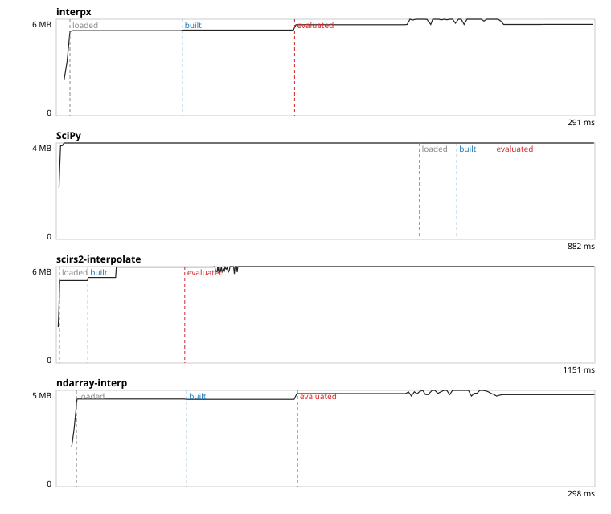
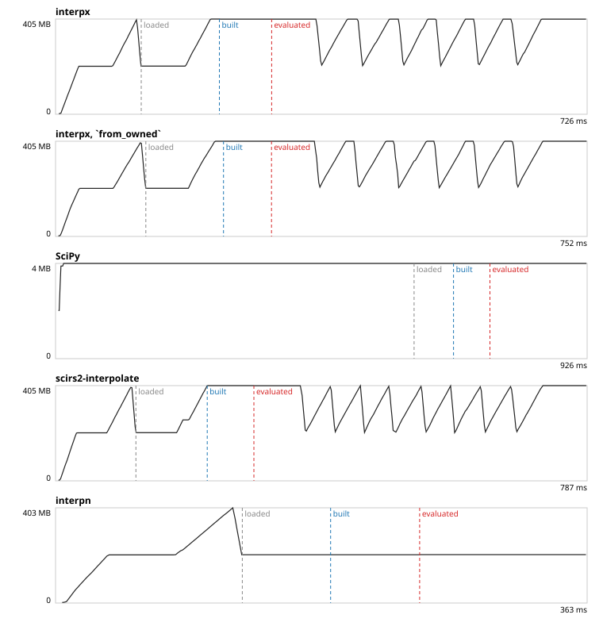
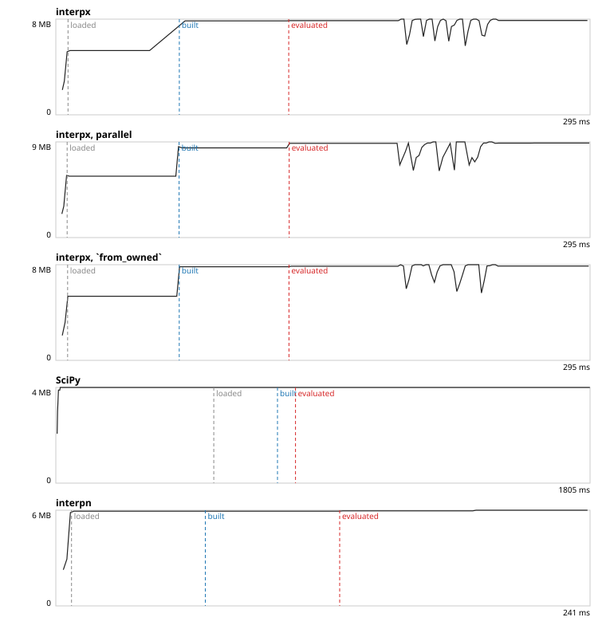
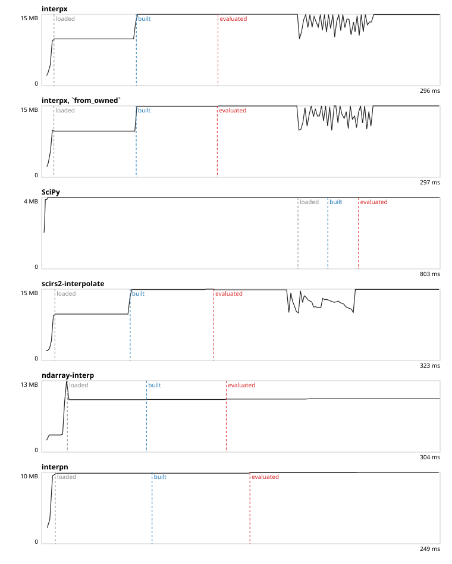
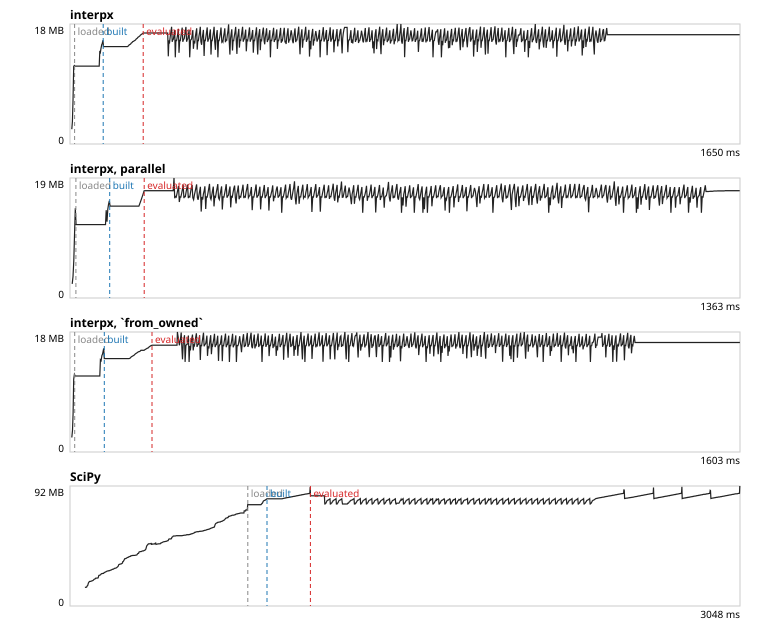
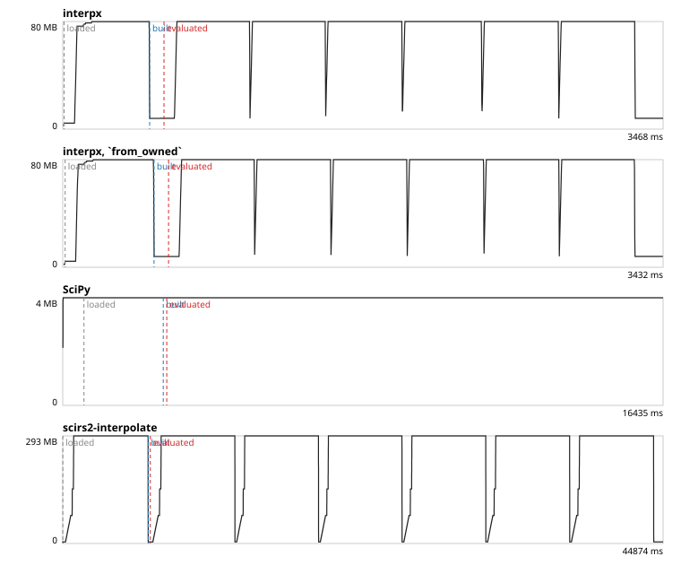
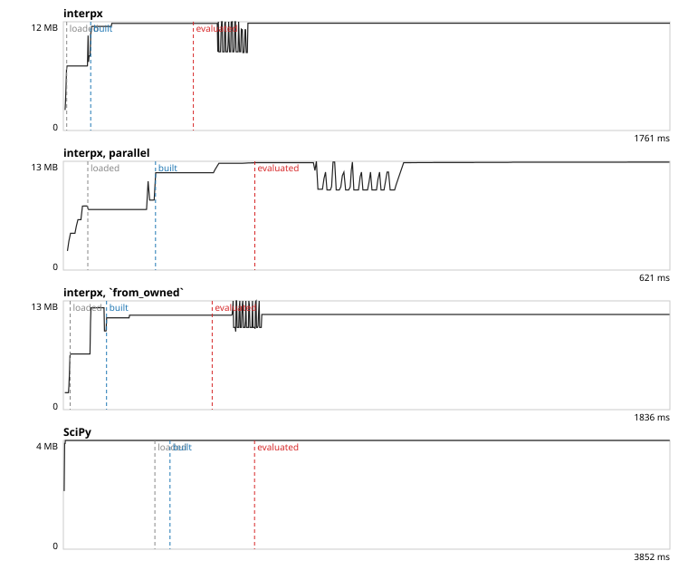

# Performance: interpx against SciPy and other Rust crates

<!-- Written by compare/perf/report.py from a run of compare/perf/run.py. Do not edit by hand: run it again. -->

Measured on 2026-10-17, at commit `79b6cedfd5`.

## How it was measured

- Machine: Intel64 Family 6 Model 191 Stepping 2, GenuineIntel, 16 logical cores, 48 GB. Windows-11-10.0.26300-SP0.
- rustc 1.99.0 (b940084d7 2026-09-28); Python 3.13.1, NumPy 2.5.4, SciPy 1.18.1.
- The other Rust crates, at the versions in `compare/perf/runners/*/Cargo.toml`: `scirs2-interpolate` (the widest of the Rust crates: one variable, grids, RBF), `ndarray-interp` (the most used for one variable; also bilinear), `interpn` (grids).
- Every library ran each case in a process of its own, pinned to one core, on one thread, on the same data. The libraries took turns case by case, 3 rounds.
- `interpx, from_owned` is interpx built from data that is handed over (`from_owned`) and so not copied. Its column is there for the types that keep their data as it is given (the grid, `NearestNDInterpolator`, `RBFInterpolator`), next to the construction from borrowed data (`new`), which is the one the comparison counts. Each of its samples is given data made just before it, which is not in the nearest cache as the data of the other constructions is: on small grids it reads slower than `new` for that reason.
- `interpx, parallel` is interpx evaluated with `eval_batch_into_par` (the `rayon` feature) on 8 threads, not pinned to a core. Every other column is one thread on one core, and the comparison counts those. A parallel batch times its first points and is shared out only when the rest is worth it, so on small cases the column reads as the serial one does.
- A time is that of one call: construction, or the evaluation of all the queries of the case (`eval_batch_into` for interpx, the call with an array for the others). It is the median of the repeats of a process, and then the median of the rounds.
- A call of two seconds or more is timed once: the construction that made the interpolator, or the evaluation that wrote the values, is its measurement, and it is not made again. A library whose construction or evaluation of a case was timed so is run on that case in the first round only, and its time is then one measurement; a call near two seconds that was timed several times goes on to the later rounds. (The rule goes by the time, whatever the library.)
- interpx is called slower where its median is more than 1.10 times another library's and its fastest repeat is slower than that library's fastest.
- Memory is the resident set size of the process, sampled every millisecond from outside it.
- Command: `perf/run.py`, run in `compare/`.

## Where interpx is slower

| family | operation | cases | interpx fastest | slower than SciPy | slower than a Rust crate |
| :--- | :--- | ---: | ---: | ---: | ---: |
| One variable | evaluation | 112 | 112 | 0 | 0 |
| One variable | construction | 112 | 74 | 0 | 38 |
| `PPoly` | evaluation | 4 | 4 | 0 | 0 |
| `PPoly` | construction | 4 | 4 | 0 | 0 |
| `BSpline` | evaluation | 4 | 4 | 0 | 0 |
| `BSpline` | construction | 4 | 4 | 0 | 0 |
| `BSplineCurve` | evaluation | 2 | 2 | 0 | 0 |
| `BSplineCurve` | construction | 2 | 2 | 0 | 0 |
| Regular grid | evaluation | 92 | 72 | 0 | 20 |
| Regular grid | construction | 92 | 29 | 37 | 46 |
| `NearestNDInterpolator` | evaluation | 16 | 16 | 0 | 0 |
| `NearestNDInterpolator` | construction | 16 | 16 | 0 | 0 |
| `RBFInterpolator` | evaluation | 61 | 61 | 0 | 0 |
| `RBFInterpolator` | construction | 61 | 61 | 0 | 0 |

197 comparisons (a case, an operation, and a library), by method. "Same values" says whether that library's values are SciPy's up to rounding: where they are not, it computes another interpolant under the same name, and its time is not that of the same work.

| method | operation | against | same values | cases | slower by | the largest |
| :--- | :--- | :--- | :--- | ---: | ---: | :--- |
| `grid/cubic` | construction | interpn | no | 8 | 1.66e+03x to 8.84e+07x | `grid/cubic/2d/auckland-ba32-0401/heldout/ascending`: 77.7 ms against 0.88 ns |
| `grid/linear` | construction | interpn | yes | 35 | 161x to 4.03e+07x | `grid/linear/4d/max200/eval1000/ascending`: 51.2 ms against 1.27 ns |
| `grid/nearest` | construction | interpn | yes | 3 | 757x to 2.41e+07x | `grid/nearest/2d/auckland-ba32-0401/heldout/ascending`: 16.5 ms against 0.68 ns |
| `grid/linear` | construction | SciPy | yes | 34 | 1.19x to 5.51e+03x | `grid/linear/4d/max200/eval1000/flipped`: 109 ms against 19.8 µs |
| `grid/nearest` | construction | SciPy | yes | 2 | 2.82x to 2.32e+03x | `grid/nearest/2d/auckland-ba32-0401/heldout/ascending`: 16.5 ms against 7.11 µs |
| `grid/linear` | construction | ndarray-interp | yes | 15 | 1.48x to 2.08e+03x | `grid/linear/2d/auckland-ba32-0401/heldout/ascending`: 17.1 ms against 8.24 µs |
| `grid/pchip` | construction | SciPy | yes | 1 | 49.2x | `grid/pchip/3d/each40/eval10000/ascending`: 467 µs against 9.48 µs |
| `oned/pchip` | construction | scirs2-interpolate | yes | 12 | 1.52x to 2.9x | `oned/pchip/n10000/sorted`: 124 µs against 42.7 µs |
| `oned/akima` | construction | scirs2-interpolate | yes | 8 | 1.52x to 2.81x | `oned/akima/n10000/shuffled`: 127 µs against 45.1 µs |
| `grid/linear` | construction | scirs2-interpolate | yes | 26 | 1.13x to 2.57x | `grid/linear/4d/max40/eval10000/ascending`: 14.3 µs against 5.56 µs |
| `oned/linear` | construction | ndarray-interp | yes | 13 | 1.21x to 2.31x | `oned/linear/n10/sorted`: 92.8 ns against 40.2 ns |
| `grid/nearest` | construction | scirs2-interpolate | yes | 3 | 1.2x to 2.15x | `grid/nearest/2d/each40/eval10000/ascending`: 591 ns against 275 ns |
| `oned/linear` | construction | scirs2-interpolate | yes | 13 | 1.16x to 1.82x | `oned/linear/n1000/shuffled`: 2.12 µs against 1.16 µs |
| `grid/linear` | evaluation | interpn | yes | 19 | 1.11x to 1.53x | `grid/linear/2d/max10/eval10/ascending`: 148 ns against 96.3 ns |
| `oned/cubic_spline` | construction | scirs2-interpolate | no | 4 | 1.2x to 1.28x | `oned/cubic_spline/n10000/sorted-uneven`: 170 µs against 132 µs |
| `grid/nearest` | evaluation | interpn | yes | 1 | 1.13x | `grid/nearest/2d/each40/eval10000/ascending`: 151 µs against 134 µs |

Every comparison where interpx is slower

"Values apart" is the distance of that library's values from SciPy's, as a share of the largest value.

| case | operation | against | interpx | the other | slower by | values apart |
| :--- | :--- | :--- | ---: | ---: | ---: | ---: |
| `grid/cubic/2d/auckland-ba32-0401/heldout/ascending` | construction | interpn | 77.7 ms | 0.88 ns | 88428544.00x | 5e-03 |
| `grid/linear/4d/max200/eval1000/ascending` | construction | interpn | 51.2 ms | 1.27 ns | 40336462.77x | 3e-16 |
| `grid/linear/4d/max200/eval100/ascending` | construction | interpn | 49.3 ms | 1.27 ns | 38802983.38x | 3e-16 |
| `grid/linear/4d/max200/eval10000/ascending` | construction | interpn | 48.2 ms | 1.27 ns | 37960625.23x | 4e-16 |
| `grid/linear/4d/max200/eval10/ascending` | construction | interpn | 48.1 ms | 1.27 ns | 37894301.54x | 2e-16 |
| `grid/linear/2d/auckland-ba32-0401/heldout/ascending` | construction | interpn | 17.1 ms | 0.68 ns | 25079222.86x | 0e+00 |
| `grid/nearest/2d/auckland-ba32-0401/heldout/ascending` | construction | interpn | 16.5 ms | 0.68 ns | 24125001.14x | 0e+00 |
| `grid/linear/3d/max200/eval10/ascending` | construction | interpn | 1.86 ms | 0.98 ns | 1907302.40x | 3e-16 |
| `grid/linear/3d/max200/eval1000/ascending` | construction | interpn | 1.72 ms | 0.98 ns | 1765785.60x | 3e-16 |
| `grid/linear/3d/max200/eval100/ascending` | construction | interpn | 1.63 ms | 0.98 ns | 1670860.80x | 3e-16 |
| `grid/linear/3d/max200/eval10000/ascending` | construction | interpn | 1.63 ms | 0.98 ns | 1668915.20x | 5e-16 |
| `grid/cubic/2d/each400/eval1000/ascending` | construction | interpn | 1.47 ms | 0.88 ns | 1668323.56x | 5e-01 |
| `grid/linear/2d/each800/eval10000/ascending` | construction | interpn | 1.01 ms | 0.68 ns | 1478070.86x | 3e-16 |
| `grid/linear/2d/each400/eval10000/ascending` | construction | interpn | 303 µs | 0.68 ns | 443465.14x | 3e-16 |
| `grid/cubic/3d/each40/eval10000/ascending` | construction | interpn | 432 µs | 0.98 ns | 442470.40x | 5e-01 |
| `grid/cubic/2d/each200/eval1000/ascending` | construction | interpn | 179 µs | 0.98 ns | 182860.80x | 2e-01 |
| `grid/cubic/2d/each100/eval1000/ascending` | construction | interpn | 40.9 µs | 0.78 ns | 52320.00x | 2e-01 |
| `grid/nearest/3d/each40/eval10000/ascending` | construction | interpn | 20.9 µs | 0.88 ns | 23758.22x | 0e+00 |
| `grid/linear/4d/max40/eval10000/ascending` | construction | interpn | 14.3 µs | 1.27 ns | 11234.46x | 5e-16 |
| `grid/linear/2d/max200/eval10000/ascending` | construction | interpn | 7.48 µs | 0.68 ns | 10939.43x | 3e-16 |
| `grid/linear/2d/max200/eval1000/ascending` | construction | interpn | 7.41 µs | 0.68 ns | 10843.43x | 2e-16 |
| `grid/linear/4d/max40/eval10/ascending` | construction | interpn | 13.1 µs | 1.27 ns | 10323.69x | 2e-16 |
| `grid/linear/2d/max200/eval10/ascending` | construction | interpn | 6.88 µs | 0.68 ns | 10057.14x | 2e-16 |
| `grid/linear/2d/max200/eval100/ascending` | construction | interpn | 6.85 µs | 0.68 ns | 10016.00x | 1e-16 |
| `grid/cubic/2d/each40/eval10000/ascending` | construction | interpn | 8.44 µs | 0.88 ns | 9603.56x | 7e-01 |
| `grid/cubic/2d/each40/eval1000/ascending` | construction | interpn | 8.42 µs | 0.88 ns | 9578.67x | 7e-01 |
| `grid/linear/4d/max40/eval1000/ascending` | construction | interpn | 13 µs | 1.37 ns | 9536.00x | 6e-16 |
| `grid/linear/4d/max40/eval100/ascending` | construction | interpn | 13 µs | 1.37 ns | 9513.14x | 2e-16 |
| `grid/linear/4d/max200/eval1000/flipped` | construction | SciPy | 109 ms | 19.8 µs | 5511.99x |  |
| `grid/linear/4d/max200/eval10000/flipped` | construction | SciPy | 109 ms | 19.9 µs | 5499.41x |  |
| `grid/linear/4d/max200/eval10/flipped` | construction | SciPy | 107 ms | 19.5 µs | 5465.56x |  |
| `grid/linear/4d/max200/eval10/ascending` | construction | SciPy | 48.1 ms | 9.09 µs | 5293.87x |  |
| `grid/linear/4d/max200/eval100/ascending` | construction | SciPy | 49.3 ms | 9.31 µs | 5291.61x |  |
| `grid/linear/4d/max200/eval10000/ascending` | construction | SciPy | 48.2 ms | 9.31 µs | 5174.13x |  |
| `grid/linear/4d/max200/eval100/flipped` | construction | SciPy | 104 ms | 20.2 µs | 5153.44x |  |
| `grid/linear/4d/max200/eval1000/ascending` | construction | SciPy | 51.2 ms | 10.1 µs | 5084.30x |  |
| `grid/linear/3d/max40/eval100/ascending` | construction | interpn | 3.14 µs | 0.88 ns | 3567.11x | 2e-16 |
| `grid/linear/3d/max40/eval1000/ascending` | construction | interpn | 2.93 µs | 0.88 ns | 3339.11x | 2e-16 |
| `grid/linear/3d/max40/eval10000/ascending` | construction | interpn | 2.86 µs | 0.88 ns | 3249.78x | 3e-16 |
| `grid/linear/3d/max40/eval10/ascending` | construction | interpn | 2.7 µs | 0.88 ns | 3071.11x | 2e-16 |
| `grid/nearest/2d/auckland-ba32-0401/heldout/ascending` | construction | SciPy | 16.5 ms | 7.11 µs | 2319.71x |  |
| `grid/linear/2d/auckland-ba32-0401/heldout/ascending` | construction | SciPy | 17.1 ms | 7.56 µs | 2268.85x |  |
| `grid/linear/2d/auckland-ba32-0401/heldout/ascending` | construction | ndarray-interp | 17.1 ms | 8.24 µs | 2080.42x | 0e+00 |
| `grid/cubic/2d/each10/eval1000/ascending` | construction | interpn | 1.46 µs | 0.88 ns | 1662.67x | 3e-01 |
| `grid/nearest/2d/each40/eval10000/ascending` | construction | interpn | 591 ns | 0.78 ns | 757.00x | 0e+00 |
| `grid/linear/2d/max40/eval10000/ascending` | construction | interpn | 386 ns | 0.68 ns | 564.00x | 4e-16 |
| `grid/linear/2d/max40/eval1000/ascending` | construction | interpn | 367 ns | 0.68 ns | 536.93x | 3e-16 |
| `grid/linear/2d/max40/eval10/ascending` | construction | interpn | 366 ns | 0.68 ns | 535.64x | 2e-16 |
| `grid/linear/2d/max40/eval100/ascending` | construction | interpn | 364 ns | 0.78 ns | 466.00x | 2e-16 |
| `grid/linear/2d/each800/eval10000/ascending` | construction | ndarray-interp | 1.01 ms | 2.44 µs | 413.73x | 6e-16 |
| `grid/linear/2d/each400/eval10000/ascending` | construction | ndarray-interp | 303 µs | 1.14 µs | 266.05x | 5e-16 |
| `grid/linear/3d/max200/eval10/ascending` | construction | SciPy | 1.86 ms | 7.51 µs | 247.93x |  |
| `grid/linear/3d/max200/eval1000/ascending` | construction | SciPy | 1.72 ms | 7.49 µs | 230.11x |  |
| `grid/linear/3d/max200/eval100/ascending` | construction | SciPy | 1.63 ms | 7.5 µs | 217.70x |  |
| `grid/linear/3d/max200/eval10000/ascending` | construction | SciPy | 1.63 ms | 7.5 µs | 217.22x |  |
| `grid/linear/3d/max10/eval10000/ascending` | construction | interpn | 184 ns | 0.88 ns | 209.11x | 4e-16 |
| `grid/linear/3d/max10/eval100/ascending` | construction | interpn | 180 ns | 0.88 ns | 204.44x | 3e-16 |
| `grid/linear/3d/max10/eval1000/ascending` | construction | interpn | 178 ns | 0.88 ns | 202.22x | 5e-16 |
| `grid/linear/3d/max10/eval10/ascending` | construction | interpn | 178 ns | 0.88 ns | 202.11x | 2e-16 |
| `grid/linear/3d/max200/eval100/flipped` | construction | SciPy | 3.13 ms | 15.8 µs | 197.92x |  |
| `grid/linear/2d/max10/eval100/ascending` | construction | interpn | 134 ns | 0.68 ns | 196.71x | 2e-16 |
| `grid/linear/3d/max200/eval10000/flipped` | construction | SciPy | 3.01 ms | 15.6 µs | 192.95x |  |
| `grid/linear/3d/max200/eval1000/flipped` | construction | SciPy | 3.06 ms | 15.9 µs | 192.65x |  |
| `grid/linear/2d/max10/eval10000/ascending` | construction | interpn | 127 ns | 0.68 ns | 185.71x | 3e-16 |
| `grid/linear/2d/max10/eval10/ascending` | construction | interpn | 125 ns | 0.68 ns | 182.57x | 1e-16 |
| `grid/linear/3d/max200/eval10/flipped` | construction | SciPy | 2.9 ms | 17.3 µs | 167.62x |  |
| `grid/linear/2d/max10/eval1000/ascending` | construction | interpn | 126 ns | 0.78 ns | 161.12x | 3e-16 |
| `grid/linear/2d/each800/eval10000/ascending` | construction | SciPy | 1.01 ms | 6.9 µs | 146.50x |  |
| `grid/linear/2d/each400/eval10000/ascending` | construction | SciPy | 303 µs | 5.92 µs | 51.23x |  |
| `grid/pchip/3d/each40/eval10000/ascending` | construction | SciPy | 467 µs | 9.48 µs | 49.22x |  |
| `grid/linear/2d/max200/eval1000/ascending` | construction | ndarray-interp | 7.41 µs | 460 ns | 16.11x | 4e-16 |
| `grid/linear/2d/max200/eval10000/ascending` | construction | ndarray-interp | 7.48 µs | 470 ns | 15.91x | 5e-16 |
| `grid/linear/2d/max200/eval10/ascending` | construction | ndarray-interp | 6.88 µs | 470 ns | 14.62x | 2e-16 |
| `grid/linear/2d/max200/eval100/ascending` | construction | ndarray-interp | 6.85 µs | 470 ns | 14.57x | 3e-16 |
| `oned/pchip/n10000/sorted` | construction | scirs2-interpolate | 124 µs | 42.7 µs | 2.90x | 2e-16 |
| `oned/pchip/n10000/shuffled-uneven` | construction | scirs2-interpolate | 122 µs | 42.7 µs | 2.85x | 3e-16 |
| `grid/linear/4d/max40/eval10000/flipped` | construction | SciPy | 56.1 µs | 19.8 µs | 2.83x |  |
| `grid/nearest/3d/each40/eval10000/ascending` | construction | SciPy | 20.9 µs | 7.4 µs | 2.82x |  |
| `oned/akima/n10000/shuffled` | construction | scirs2-interpolate | 127 µs | 45.1 µs | 2.81x | 1e-16 |
| `grid/linear/4d/max40/eval10/flipped` | construction | SciPy | 56.4 µs | 20.2 µs | 2.79x |  |
| `oned/pchip/n10000/sorted-uneven` | construction | scirs2-interpolate | 117 µs | 42.7 µs | 2.73x | 3e-16 |
| `oned/akima/n10000/sorted` | construction | scirs2-interpolate | 129 µs | 48.4 µs | 2.67x | 1e-16 |
| `oned/pchip/n10000/shuffled` | construction | scirs2-interpolate | 113 µs | 43 µs | 2.63x | 2e-16 |
| `grid/linear/4d/max40/eval1000/flipped` | construction | SciPy | 51.5 µs | 20 µs | 2.58x |  |
| `grid/linear/4d/max40/eval10000/ascending` | construction | scirs2-interpolate | 14.3 µs | 5.56 µs | 2.57x | 4e-16 |
| `grid/linear/2d/max40/eval10000/ascending` | construction | ndarray-interp | 386 ns | 152 ns | 2.54x | 4e-16 |
| `grid/linear/2d/max200/eval1000/ascending` | construction | scirs2-interpolate | 7.41 µs | 2.95 µs | 2.51x | 2e-16 |
| `grid/linear/2d/max40/eval1000/ascending` | construction | ndarray-interp | 367 ns | 152 ns | 2.42x | 4e-16 |
| `grid/linear/4d/max40/eval10/ascending` | construction | scirs2-interpolate | 13.1 µs | 5.45 µs | 2.41x | 2e-16 |
| `grid/linear/2d/max40/eval10/ascending` | construction | ndarray-interp | 366 ns | 152 ns | 2.41x | 2e-16 |
| `grid/linear/2d/max40/eval100/ascending` | construction | ndarray-interp | 364 ns | 152 ns | 2.39x | 2e-16 |
| `grid/linear/4d/max40/eval1000/ascending` | construction | scirs2-interpolate | 13 µs | 5.46 µs | 2.39x | 2e-16 |
| `grid/linear/4d/max40/eval100/flipped` | construction | SciPy | 51.8 µs | 21.8 µs | 2.38x |  |
| `grid/linear/2d/max200/eval100/ascending` | construction | scirs2-interpolate | 6.85 µs | 2.96 µs | 2.32x | 2e-16 |
| `oned/linear/n10/sorted` | construction | ndarray-interp | 92.8 ns | 40.2 ns | 2.31x | 0e+00 |
| `grid/linear/2d/max200/eval10000/ascending` | construction | scirs2-interpolate | 7.48 µs | 3.3 µs | 2.27x | 2e-16 |
| `grid/linear/2d/max200/eval10/ascending` | construction | scirs2-interpolate | 6.88 µs | 3.09 µs | 2.23x | 1e-16 |
| `grid/linear/3d/max40/eval100/ascending` | construction | scirs2-interpolate | 3.14 µs | 1.42 µs | 2.21x | 1e-16 |
| `grid/linear/4d/max40/eval100/ascending` | construction | scirs2-interpolate | 13 µs | 5.96 µs | 2.18x | 3e-16 |
| `grid/nearest/2d/each40/eval10000/ascending` | construction | scirs2-interpolate | 591 ns | 275 ns | 2.15x | 0e+00 |
| `grid/nearest/3d/each40/eval10000/ascending` | construction | scirs2-interpolate | 20.9 µs | 10.2 µs | 2.04x | 0e+00 |
| `oned/linear/n10/shuffled` | construction | ndarray-interp | 92.5 ns | 45.5 ns | 2.03x | 0e+00 |
| `grid/linear/3d/max40/eval1000/ascending` | construction | scirs2-interpolate | 2.93 µs | 1.46 µs | 2.01x | 2e-16 |
| `grid/linear/3d/max40/eval10/ascending` | construction | scirs2-interpolate | 2.7 µs | 1.39 µs | 1.94x | 1e-16 |
| `grid/linear/3d/max40/eval10000/ascending` | construction | scirs2-interpolate | 2.86 µs | 1.5 µs | 1.90x | 2e-16 |
| `grid/linear/2d/max40/eval10000/ascending` | construction | scirs2-interpolate | 386 ns | 204 ns | 1.89x | 2e-16 |
| `oned/akima/n1000/sorted` | construction | scirs2-interpolate | 8.27 µs | 4.4 µs | 1.88x | 3e-17 |
| `oned/pchip/n1000/shuffled` | construction | scirs2-interpolate | 8.58 µs | 4.59 µs | 1.87x | 2e-16 |
| `grid/linear/2d/max40/eval1000/ascending` | construction | scirs2-interpolate | 367 ns | 199 ns | 1.85x | 3e-16 |
| `grid/linear/2d/max40/eval10/ascending` | construction | scirs2-interpolate | 366 ns | 200 ns | 1.83x | 4e-17 |
| `oned/linear/n1000/shuffled` | construction | scirs2-interpolate | 2.12 µs | 1.16 µs | 1.82x | 0e+00 |
| `oned/pchip/n1000/sorted` | construction | scirs2-interpolate | 8.35 µs | 4.6 µs | 1.81x | 2e-16 |
| `oned/linear/n10000/shuffled` | construction | scirs2-interpolate | 21.3 µs | 12 µs | 1.78x | 0e+00 |
| `oned/akima/n1000/shuffled` | construction | scirs2-interpolate | 8.39 µs | 4.83 µs | 1.74x | 3e-17 |
| `oned/pchip/n50/shuffled` | construction | scirs2-interpolate | 544 ns | 327 ns | 1.66x | 1e-16 |
| `oned/akima/n100/shuffled` | construction | scirs2-interpolate | 889 ns | 538 ns | 1.65x | 1e-16 |
| `grid/linear/2d/max40/eval100/ascending` | construction | scirs2-interpolate | 364 ns | 221 ns | 1.65x | 3e-16 |
| `oned/linear/n10000/sorted` | construction | scirs2-interpolate | 19.6 µs | 11.9 µs | 1.64x | 0e+00 |
| `oned/pchip/n100/shuffled` | construction | scirs2-interpolate | 964 ns | 588 ns | 1.64x | 2e-16 |
| `oned/pchip/n100/sorted` | construction | scirs2-interpolate | 880 ns | 540 ns | 1.63x | 2e-16 |
| `oned/pchip/n100/shuffled-uneven` | construction | scirs2-interpolate | 966 ns | 594 ns | 1.63x | 2e-16 |
| `oned/pchip/n100/sorted-uneven` | construction | scirs2-interpolate | 880 ns | 542 ns | 1.62x | 2e-16 |
| `oned/linear/n1000/sorted` | construction | scirs2-interpolate | 1.93 µs | 1.2 µs | 1.60x | 0e+00 |
| `grid/linear/2d/max10/eval10/ascending` | construction | ndarray-interp | 125 ns | 77.9 ns | 1.60x | 1e-16 |
| `grid/linear/2d/max10/eval100/ascending` | construction | ndarray-interp | 134 ns | 85.3 ns | 1.58x | 4e-16 |
| `oned/akima/n100/sorted` | construction | scirs2-interpolate | 892 ns | 573 ns | 1.56x | 1e-16 |
| `grid/linear/2d/max10/eval10/ascending` | evaluation | interpn | 148 ns | 96.3 ns | 1.53x | 1e-16 |
| `oned/linear/n50/shuffled` | construction | ndarray-interp | 153 ns | 99.8 ns | 1.53x | 0e+00 |
| `oned/linear/n50/sorted` | construction | ndarray-interp | 167 ns | 110 ns | 1.53x | 0e+00 |
| `oned/pchip/n50/sorted` | construction | scirs2-interpolate | 501 ns | 328 ns | 1.52x | 1e-16 |
| `oned/linear/n10000/sorted-uneven` | construction | scirs2-interpolate | 19.5 µs | 12.8 µs | 1.52x | 6e-17 |
| `oned/akima/n50/shuffled` | construction | scirs2-interpolate | 554 ns | 365 ns | 1.52x | 1e-16 |
| `oned/akima/n50/sorted` | construction | scirs2-interpolate | 503 ns | 332 ns | 1.52x | 1e-16 |
| `grid/linear/4d/max40/eval10000/ascending` | construction | SciPy | 14.3 µs | 9.41 µs | 1.52x |  |
| `oned/linear/n10000/shuffled-uneven` | construction | scirs2-interpolate | 19.4 µs | 12.9 µs | 1.51x | 6e-17 |
| `grid/linear/2d/max10/eval10000/ascending` | construction | ndarray-interp | 127 ns | 84.4 ns | 1.50x | 4e-16 |
| `oned/linear/n100/shuffled-uneven` | construction | ndarray-interp | 246 ns | 166 ns | 1.48x | 0e+00 |
| `grid/linear/2d/max10/eval1000/ascending` | construction | ndarray-interp | 126 ns | 85.2 ns | 1.48x | 3e-16 |
| `oned/linear/n100/sorted-uneven` | construction | ndarray-interp | 243 ns | 166 ns | 1.46x | 0e+00 |
| `grid/linear/3d/max200/eval10/ascending` | construction | scirs2-interpolate | 1.86 ms | 1.29 ms | 1.45x | 3e-16 |
| `oned/linear/n100/sorted` | construction | ndarray-interp | 262 ns | 183 ns | 1.44x | 0e+00 |
| `oned/linear/n100/shuffled` | construction | ndarray-interp | 262 ns | 182 ns | 1.44x | 0e+00 |
| `grid/linear/3d/max10/eval10/ascending` | evaluation | interpn | 198 ns | 139 ns | 1.43x | 2e-16 |
| `grid/linear/4d/max40/eval10/ascending` | construction | SciPy | 13.1 µs | 9.31 µs | 1.41x |  |
| `oned/linear/n1000/shuffled` | construction | ndarray-interp | 2.12 µs | 1.51 µs | 1.40x | 0e+00 |
| `oned/linear/n1000/sorted` | construction | ndarray-interp | 1.93 µs | 1.38 µs | 1.40x | 0e+00 |
| `grid/linear/4d/max40/eval100/ascending` | construction | SciPy | 13 µs | 9.33 µs | 1.39x |  |
| `oned/linear/n10000/shuffled` | construction | ndarray-interp | 21.3 µs | 15.3 µs | 1.39x | 0e+00 |
| `grid/linear/3d/max10/eval100/ascending` | evaluation | interpn | 1.92 µs | 1.4 µs | 1.37x | 3e-16 |
| `grid/linear/2d/max10/eval1000/ascending` | evaluation | interpn | 12.5 µs | 9.22 µs | 1.35x | 3e-16 |
| `grid/linear/3d/max200/eval1000/ascending` | construction | scirs2-interpolate | 1.72 ms | 1.28 ms | 1.35x | 3e-16 |
| `grid/linear/3d/max10/eval10000/ascending` | evaluation | interpn | 191 µs | 143 µs | 1.34x | 4e-16 |
| `grid/linear/2d/max10/eval100/ascending` | evaluation | interpn | 1.25 µs | 937 ns | 1.33x | 2e-16 |
| `oned/linear/n100/shuffled` | construction | scirs2-interpolate | 262 ns | 197 ns | 1.33x | 0e+00 |
| `oned/linear/n10000/sorted-uneven` | construction | ndarray-interp | 19.5 µs | 14.8 µs | 1.32x | 0e+00 |
| `oned/linear/n50/sorted` | construction | scirs2-interpolate | 167 ns | 127 ns | 1.31x | 0e+00 |
| `grid/linear/4d/max40/eval1000/ascending` | construction | SciPy | 13 µs | 10 µs | 1.30x |  |
| `grid/linear/4d/max200/eval1000/ascending` | construction | scirs2-interpolate | 51.2 ms | 39.5 ms | 1.30x | 3e-16 |
| `oned/linear/n100/shuffled-uneven` | construction | scirs2-interpolate | 246 ns | 191 ns | 1.29x | 3e-17 |
| `grid/linear/2d/max200/eval10000/ascending` | construction | SciPy | 7.48 µs | 5.8 µs | 1.29x |  |
| `oned/cubic_spline/n10000/sorted-uneven` | construction | scirs2-interpolate | 170 µs | 132 µs | 1.28x | 7e-06 |
| `grid/linear/2d/each800/eval10000/ascending` | construction | scirs2-interpolate | 1.01 ms | 788 µs | 1.28x | 2e-16 |
| `oned/linear/n50/shuffled` | construction | scirs2-interpolate | 153 ns | 119 ns | 1.28x | 0e+00 |
| `grid/linear/3d/max200/eval100/ascending` | construction | scirs2-interpolate | 1.63 ms | 1.27 ms | 1.28x | 3e-16 |
| `oned/cubic_spline/n1000/sorted` | construction | scirs2-interpolate | 16.9 µs | 13.2 µs | 1.28x | 4e-04 |
| `oned/linear/n100/sorted-uneven` | construction | scirs2-interpolate | 243 ns | 190 ns | 1.27x | 3e-17 |
| `oned/cubic_spline/n10000/shuffled` | construction | scirs2-interpolate | 170 µs | 134 µs | 1.27x | 4e-05 |
| `grid/linear/2d/max200/eval1000/ascending` | construction | SciPy | 7.41 µs | 5.84 µs | 1.27x |  |
| `oned/linear/n100/sorted` | construction | scirs2-interpolate | 262 ns | 208 ns | 1.26x | 0e+00 |
| `grid/linear/3d/max10/eval1000/ascending` | evaluation | interpn | 19.1 µs | 15.2 µs | 1.25x | 5e-16 |
| `grid/linear/2d/auckland-ba32-0401/heldout/ascending` | construction | scirs2-interpolate | 17.1 ms | 13.8 ms | 1.25x | 0e+00 |
| `grid/linear/2d/max10/eval10000/ascending` | evaluation | interpn | 125 µs | 101 µs | 1.23x | 3e-16 |
| `grid/linear/2d/max200/eval100/flipped` | construction | SciPy | 14.4 µs | 11.7 µs | 1.23x |  |
| `grid/linear/4d/max200/eval100/ascending` | construction | scirs2-interpolate | 49.3 ms | 40.2 ms | 1.22x | 1e-16 |
| `grid/linear/2d/max200/eval10000/flipped` | construction | SciPy | 14.4 µs | 11.8 µs | 1.22x |  |
| `grid/linear/2d/max200/eval10/flipped` | construction | SciPy | 14.4 µs | 11.8 µs | 1.22x |  |
| `grid/linear/4d/max200/eval10/ascending` | construction | scirs2-interpolate | 48.1 ms | 39.7 ms | 1.21x | 2e-16 |
| `grid/linear/2d/max200/eval1000/flipped` | construction | SciPy | 14.2 µs | 11.7 µs | 1.21x |  |
| `grid/linear/4d/max40/eval10/ascending` | evaluation | interpn | 327 ns | 271 ns | 1.21x | 2e-16 |
| `oned/linear/n10000/shuffled-uneven` | construction | ndarray-interp | 19.4 µs | 16.1 µs | 1.21x | 0e+00 |
| `oned/cubic_spline/n10000/shuffled-uneven` | construction | scirs2-interpolate | 159 µs | 132 µs | 1.20x | 7e-06 |
| `grid/nearest/2d/auckland-ba32-0401/heldout/ascending` | construction | scirs2-interpolate | 16.5 ms | 13.7 ms | 1.20x | 0e+00 |
| `grid/linear/2d/max200/eval10/ascending` | construction | SciPy | 6.88 µs | 5.79 µs | 1.19x |  |
| `grid/linear/4d/max200/eval10000/ascending` | construction | scirs2-interpolate | 48.2 ms | 41.2 ms | 1.17x | 4e-16 |
| `grid/linear/2d/max40/eval10/ascending` | evaluation | interpn | 157 ns | 134 ns | 1.17x | 2e-16 |
| `grid/linear/3d/max200/eval10/ascending` | evaluation | interpn | 304 ns | 261 ns | 1.16x | 3e-16 |
| `grid/linear/2d/max40/eval100/ascending` | evaluation | interpn | 1.59 µs | 1.37 µs | 1.16x | 2e-16 |
| `oned/linear/n10/shuffled` | construction | scirs2-interpolate | 92.5 ns | 79.9 ns | 1.16x | 0e+00 |
| `grid/linear/2d/max40/eval10000/ascending` | evaluation | interpn | 152 µs | 132 µs | 1.15x | 4e-16 |
| `grid/linear/4d/max200/eval1000/ascending` | evaluation | interpn | 41.1 µs | 35.6 µs | 1.15x | 3e-16 |
| `grid/linear/2d/max40/eval1000/ascending` | evaluation | interpn | 15.2 µs | 13.2 µs | 1.15x | 3e-16 |
| `grid/linear/3d/max200/eval100/ascending` | evaluation | interpn | 3 µs | 2.61 µs | 1.15x | 3e-16 |
| `grid/linear/4d/max200/eval100/ascending` | evaluation | interpn | 4.1 µs | 3.61 µs | 1.14x | 3e-16 |
| `grid/linear/2d/each400/eval10000/ascending` | construction | scirs2-interpolate | 303 µs | 268 µs | 1.13x | 2e-16 |
| `grid/linear/4d/max40/eval10000/ascending` | evaluation | interpn | 306 µs | 270 µs | 1.13x | 5e-16 |
| `grid/nearest/2d/each40/eval10000/ascending` | evaluation | interpn | 151 µs | 134 µs | 1.13x | 0e+00 |
| `grid/linear/2d/max200/eval10/ascending` | evaluation | interpn | 195 ns | 177 ns | 1.11x | 2e-16 |

## Runs that failed

| case | library | how |
| :--- | :--- | :--- |
| `grid/linear/4d/max10/eval10/ascending` | interpn | the library refused the case: "All grids must have at least 2 entries" |
| `grid/linear/4d/max10/eval10/ascending` | scirs2-interpolate | the library refused the case: InvalidInput { message: "Dimension 3 has less than 2 points" } |
| `grid/linear/4d/max10/eval100/ascending` | interpn | the library refused the case: "All grids must have at least 2 entries" |
| `grid/linear/4d/max10/eval100/ascending` | scirs2-interpolate | the library refused the case: InvalidInput { message: "Dimension 3 has less than 2 points" } |
| `grid/linear/4d/max10/eval1000/ascending` | interpn | the library refused the case: "All grids must have at least 2 entries" |
| `grid/linear/4d/max10/eval1000/ascending` | scirs2-interpolate | the library refused the case: InvalidInput { message: "Dimension 3 has less than 2 points" } |
| `grid/linear/4d/max10/eval10000/ascending` | interpn | the library refused the case: "All grids must have at least 2 entries" |
| `grid/linear/4d/max10/eval10000/ascending` | scirs2-interpolate | the library refused the case: InvalidInput { message: "Dimension 3 has less than 2 points" } |
| `grid/pchip/2d/auckland-ba32-0401/heldout/ascending` | SciPy | MemoryError: Unable to allocate 695. GiB for an array with shape (25913999, 3601) and data type float64 |

## Runs near the time limit

A run (one library on one case, a process of its own) is stopped at 15 minutes. The longest run that finished took 292 s, 32% of that: scirs2-interpolate on `rbf/thin_plate_spline/global/ghcn-tmax-20250101/heldout`.

No run took more than half the limit (450 s).

## Real-world data

Two data sets, each taken whole in the unit its source gives it out in; what was taken and how it was divided was fixed before anything was measured (`compare/perf/real.py`, docs/design.ja.md section 8.4.7).

- `auckland-ba32-0401`: Auckland Part 1 LiDAR 1m DEM (2024), tile BA32_10000_0401. 4800 by 7200 cells of 1 m. The grid is every second row and column (and the last ones); every other cell is a query, and its elevation is the value held out. Licensed by Regional Software Holdings Limited for re-use under CC-BY-4.0. Hosted by Toitū Te Whenua Land Information New Zealand (https://registry.opendata.aws/nz-elevation).
- `ghcn-tmax-20250101`: GHCN-Daily, maximum temperature of 2025-01-01, every station; longitude and latitude in degrees, as they are. Of every 10 stations in the order of the file the last is a query, and its temperature is the value held out. The RBF kernels are those without a shape parameter. NOAA Global Historical Climatology Network Daily (GHCN-D), from https://registry.opendata.aws/noaa-ghcn (CC0 1.0).

These cases are also in the tables of their families below and in the counts above. Here they are with the error: the largest and the root mean square distance from the values held out (metres, and degrees Celsius), and the number of queries a library gave no value. A library missing from a case does not have it, or did not finish (see the runs that failed).

`grid/nearest/2d/auckland-ba32-0401/heldout/ascending` (8646001 points, 25913999 queries)

| library | construction | evaluation | largest error | RMS error | no value |
| :--- | ---: | ---: | ---: | ---: | ---: |
| interpx | 16.5 ms | 354 ms | 15.5 | 0.178 | 0 |
| interpx, parallel | 16.5 ms | 60.6 ms | 15.5 | 0.178 | 0 |
| interpx, `from_owned` | 5.03 ms | 362 ms | 15.5 | 0.178 | 0 |
| SciPy | 7.11 µs | 1.32 s | 15.5 | 0.178 | 0 |
| scirs2-interpolate | 13.7 ms | 159 s | 15.5 | 0.178 | 0 |
| interpn | 0.68 ns | 744 ms | 15.5 | 0.178 | 0 |

`grid/linear/2d/auckland-ba32-0401/heldout/ascending` (8646001 points, 25913999 queries)

| library | construction | evaluation | largest error | RMS error | no value |
| :--- | ---: | ---: | ---: | ---: | ---: |
| interpx | 17.1 ms | 365 ms | 6.74 | 0.0601 | 0 |
| interpx, parallel | 16.7 ms | 66.2 ms | 6.74 | 0.0601 | 0 |
| interpx, `from_owned` | 5.15 ms | 373 ms | 6.74 | 0.0601 | 0 |
| SciPy | 7.56 µs | 1.1 s | 6.74 | 0.0601 | 0 |
| scirs2-interpolate | 13.8 ms | 70.7 s | 6.74 | 0.0601 | 0 |
| ndarray-interp | 8.24 µs | 348 ms | 6.74 | 0.0601 | 0 |
| interpn | 0.68 ns | 790 ms | 6.74 | 0.0601 | 0 |

`grid/cubic/2d/auckland-ba32-0401/heldout/ascending` (8646001 points, 25913999 queries)

| library | construction | evaluation | largest error | RMS error | no value |
| :--- | ---: | ---: | ---: | ---: | ---: |
| interpx | 77.7 ms | 778 ms | 6.77 | 0.0507 | 0 |
| interpx, parallel | 73.3 ms | 127 ms | 6.77 | 0.0507 | 0 |
| interpx, `from_owned` | 67.9 ms | 771 ms | 6.77 | 0.0507 | 0 |
| SciPy | 13.9 s | 31.8 s | 6.77 | 0.0507 | 0 |
| interpn | 0.88 ns | 1.75 s | 6.76 | 0.0517 | 0 |

`grid/quintic/2d/auckland-ba32-0401/heldout/ascending` (8646001 points, 25913999 queries)

| library | construction | evaluation | largest error | RMS error | no value |
| :--- | ---: | ---: | ---: | ---: | ---: |
| interpx | 94.4 ms | 1.23 s | 6.77 | 0.0517 | 0 |
| interpx, parallel | 90.2 ms | 209 ms | 6.77 | 0.0517 | 0 |
| interpx, `from_owned` | 88.6 ms | 1.27 s | 6.77 | 0.0517 | 0 |
| SciPy | 19.9 s | 34.1 s | 6.77 | 0.0517 | 0 |

`grid/pchip/2d/auckland-ba32-0401/heldout/ascending` (8646001 points, 25913999 queries)

| library | construction | evaluation | largest error | RMS error | no value |
| :--- | ---: | ---: | ---: | ---: | ---: |
| interpx | 71.9 ms | 1.02 s | 6.75 | 0.049 | 0 |
| interpx, parallel | 73.3 ms | 174 ms | 6.75 | 0.049 | 0 |
| interpx, `from_owned` | 65.6 ms | 1.09 s | 6.75 | 0.049 | 0 |

`nearest_nd/ghcn-tmax-20250101/heldout` (10838 points, 1204 queries)

| library | construction | evaluation | largest error | RMS error | no value |
| :--- | ---: | ---: | ---: | ---: | ---: |
| interpx | 523 µs | 155 µs | 25 | 3.42 | 0 |
| interpx, parallel | 567 µs | 72 µs | 25 | 3.42 | 0 |
| interpx, `from_owned` | 530 µs | 155 µs | 25 | 3.42 | 0 |
| SciPy | 1.85 ms | 530 µs | 25 | 3.42 | 0 |

`rbf/linear/global/ghcn-tmax-20250101/heldout` (10838 points, 1204 queries)

| library | construction | evaluation | largest error | RMS error | no value |
| :--- | ---: | ---: | ---: | ---: | ---: |
| interpx | 18.2 s | 19.8 ms | 20.8 | 2.74 | 0 |
| interpx, parallel | 16.7 s | 3.31 ms | 20.8 | 2.74 | 0 |
| interpx, `from_owned` | 17.1 s | 20.1 ms | 20.8 | 2.74 | 0 |
| SciPy | 119 s | 50.3 ms | 20.8 | 2.74 | 0 |
| scirs2-interpolate | 283 s | 237 ms | 20.8 | 2.74 | 0 |

`rbf/linear/k50/ghcn-tmax-20250101/heldout` (10838 points, 1204 queries)

| library | construction | evaluation | largest error | RMS error | no value |
| :--- | ---: | ---: | ---: | ---: | ---: |
| interpx | 686 µs | 18.1 ms | 20.8 | 2.75 | 0 |
| interpx, parallel | 752 µs | 3.27 ms | 20.8 | 2.75 | 0 |
| interpx, `from_owned` | 641 µs | 18.6 ms | 20.8 | 2.75 | 0 |
| SciPy | 1.94 ms | 43.5 ms | 20.8 | 2.75 | 0 |

`rbf/thin_plate_spline/global/ghcn-tmax-20250101/heldout` (10838 points, 1204 queries)

| library | construction | evaluation | largest error | RMS error | no value |
| :--- | ---: | ---: | ---: | ---: | ---: |
| interpx | 17.5 s | 82.7 ms | 102 | 5.67 | 0 |
| interpx, parallel | 16.9 s | 16.6 ms | 102 | 5.67 | 0 |
| interpx, `from_owned` | 17.1 s | 80.8 ms | 102 | 5.67 | 0 |
| SciPy | 111 s | 114 ms | 102 | 5.67 | 0 |
| scirs2-interpolate | 290 s | 389 ms | 93.7 | 5.41 | 0 |

`rbf/thin_plate_spline/k50/ghcn-tmax-20250101/heldout` (10838 points, 1204 queries)

| library | construction | evaluation | largest error | RMS error | no value |
| :--- | ---: | ---: | ---: | ---: | ---: |
| interpx | 717 µs | 29.5 ms | 102 | 5.66 | 0 |
| interpx, parallel | 767 µs | 5.26 ms | 102 | 5.66 | 0 |
| interpx, `from_owned` | 670 µs | 28.6 ms | 102 | 5.66 | 0 |
| SciPy | 1.83 ms | 58.9 ms | 102 | 5.66 | 0 |

`rbf/cubic/global/ghcn-tmax-20250101/heldout` (10838 points, 1204 queries)

| library | construction | evaluation | largest error | RMS error | no value |
| :--- | ---: | ---: | ---: | ---: | ---: |
| interpx | 17.6 s | 19 ms | 587 | 27.1 | 0 |
| interpx, parallel | 16.7 s | 3.26 ms | 587 | 27.1 | 0 |
| interpx, `from_owned` | 16.8 s | 17.8 ms | 587 | 27.1 | 0 |
| SciPy | 111 s | 52.1 ms | 597 | 24.4 | 0 |
| scirs2-interpolate | 283 s | 262 ms | 100 | 8.48 | 0 |

`rbf/cubic/k50/ghcn-tmax-20250101/heldout` (10838 points, 1204 queries)

| library | construction | evaluation | largest error | RMS error | no value |
| :--- | ---: | ---: | ---: | ---: | ---: |
| interpx | 717 µs | 21 ms | 567 | 25.3 | 0 |
| interpx, parallel | 758 µs | 3.66 ms | 567 | 25.3 | 0 |
| interpx, `from_owned` | 647 µs | 21.6 ms | 567 | 25.3 | 0 |
| SciPy | 1.74 ms | 47.7 ms | 567 | 25.3 | 0 |

`rbf/quintic/global/ghcn-tmax-20250101/heldout` (10838 points, 1204 queries)

| library | construction | evaluation | largest error | RMS error | no value |
| :--- | ---: | ---: | ---: | ---: | ---: |
| interpx | 17.7 s | 22.4 ms | 2.55e+05 | 1.36e+04 | 0 |
| interpx, parallel | 16.7 s | 4.21 ms | 2.55e+05 | 1.36e+04 | 0 |
| interpx, `from_owned` | 16.9 s | 20.9 ms | 2.55e+05 | 1.36e+04 | 0 |
| SciPy | 116 s | 51.7 ms | 9.39e+04 | 4.92e+03 | 0 |
| scirs2-interpolate | 284 s | 275 ms | 6.56e+16 | 2.85e+15 | 0 |

`rbf/quintic/k50/ghcn-tmax-20250101/heldout` (10838 points, 1204 queries)

| library | construction | evaluation | largest error | RMS error | no value |
| :--- | ---: | ---: | ---: | ---: | ---: |
| interpx | 789 µs | 21.8 ms | 3.74e+03 | 199 | 0 |
| interpx, parallel | 786 µs | 3.97 ms | 3.74e+03 | 199 | 0 |
| interpx, `from_owned` | 682 µs | 22 ms | 3.74e+03 | 199 | 0 |
| SciPy | 1.73 ms | 50.9 ms | 3.74e+03 | 200 | 0 |

## One variable

Data of `n` points, evaluated at `4 n` points: in order (`sorted`) and in no order (`shuffled`).

### Evaluation

| case | interpx | interpx, parallel | SciPy | scirs2-interpolate | ndarray-interp | interpx against the fastest other |
| :--- | ---: | ---: | ---: | ---: | ---: | ---: |
| `linear/n10/sorted` | 139 ns | 186 ns | 4.99 µs | 273 ns | 250 ns | 1.8x faster |
| `linear/n10/shuffled` | 170 ns | 229 ns | 5.03 µs | 273 ns | 250 ns | 1.5x faster |
| `nearest/n10/sorted` | 170 ns | 212 ns | 9.24 µs | 269 ns |  | 1.6x faster |
| `nearest/n10/shuffled` | 294 ns | 393 ns | 9.41 µs | 296 ns |  | 1x faster |
| `previous/n10/sorted` | 168 ns | 206 ns | 10.6 µs |  |  | 63x faster |
| `previous/n10/shuffled` | 284 ns | 323 ns | 11.8 µs |  |  | 41x faster |
| `bspline1/n10/sorted` | 215 ns | 289 ns | 2.9 µs |  |  | 13x faster |
| `bspline1/n10/shuffled` | 578 ns | 603 ns | 2.7 µs |  |  | 4.7x faster |
| `bspline2/n10/sorted` | 269 ns | 358 ns | 3.09 µs |  |  | 11x faster |
| `bspline2/n10/shuffled` | 339 ns | 414 ns | 3.09 µs |  |  | 9.1x faster |
| `bspline3/n10/sorted` | 375 ns | 449 ns | 3.58 µs |  |  | 9.5x faster |
| `bspline3/n10/shuffled` | 440 ns | 564 ns | 3.89 µs |  |  | 8.8x faster |
| `cubic_spline/n10/sorted` | 151 ns | 211 ns | 3.6 µs | 275 ns | 333 ns | 1.8x faster |
| `cubic_spline/n10/shuffled` | 227 ns | 290 ns | 3.94 µs | 283 ns | 324 ns | 1.3x faster |
| `pchip/n10/sorted` | 144 ns | 193 ns | 3.65 µs | 319 ns |  | 2.2x faster |
| `pchip/n10/shuffled` | 196 ns | 281 ns | 3.71 µs | 318 ns |  | 1.6x faster |
| `akima/n10/sorted` | 139 ns | 195 ns | 3.57 µs | 248 ns |  | 1.8x faster |
| `akima/n10/shuffled` | 207 ns | 282 ns | 3.66 µs | 262 ns |  | 1.3x faster |
| `makima/n10/sorted` | 151 ns | 201 ns | 3.68 µs |  |  | 24x faster |
| `makima/n10/shuffled` | 206 ns | 281 ns | 3.98 µs |  |  | 19x faster |
| `linear/n50/sorted` | 728 ns | 798 ns | 6.06 µs | 1.73 µs | 1.24 µs | 1.7x faster |
| `linear/n50/shuffled` | 808 ns | 860 ns | 8.02 µs | 1.71 µs | 1.26 µs | 1.6x faster |
| `nearest/n50/sorted` | 850 ns | 891 ns | 11.2 µs | 1.67 µs |  | 2x faster |
| `nearest/n50/shuffled` | 1.52 µs | 1.59 µs | 11.2 µs | 1.69 µs |  | 1.1x faster |
| `previous/n50/sorted` | 844 ns | 892 ns | 12.6 µs |  |  | 15x faster |
| `previous/n50/shuffled` | 1.38 µs | 1.41 µs | 12.6 µs |  |  | 9.2x faster |
| `bspline1/n50/sorted` | 1.18 µs | 1.32 µs | 3.95 µs |  |  | 3.3x faster |
| `bspline1/n50/shuffled` | 2.78 µs | 2.85 µs | 5.15 µs |  |  | 1.9x faster |
| `bspline2/n50/sorted` | 1.36 µs | 1.59 µs | 6.39 µs |  |  | 4.7x faster |
| `bspline2/n50/shuffled` | 2.02 µs | 2.09 µs | 7.27 µs |  |  | 3.6x faster |
| `bspline3/n50/sorted` | 1.92 µs | 1.89 µs | 8.82 µs |  |  | 4.6x faster |
| `bspline3/n50/shuffled` | 2.8 µs | 3.16 µs | 9.32 µs |  |  | 3.3x faster |
| `cubic_spline/n50/sorted` | 736 ns | 768 ns | 5.36 µs | 4.94 µs | 1.61 µs | 2.2x faster |
| `cubic_spline/n50/shuffled` | 1.08 µs | 1.05 µs | 5.65 µs | 4.02 µs | 1.62 µs | 1.5x faster |
| `pchip/n50/sorted` | 686 ns | 833 ns | 5.57 µs | 4.25 µs |  | 6.2x faster |
| `pchip/n50/shuffled` | 1.02 µs | 1.04 µs | 5.52 µs | 3.68 µs |  | 3.6x faster |
| `akima/n50/sorted` | 680 ns | 819 ns | 5.21 µs | 4.6 µs |  | 6.8x faster |
| `akima/n50/shuffled` | 987 ns | 1.15 µs | 5.59 µs | 4.38 µs |  | 4.4x faster |
| `makima/n50/sorted` | 733 ns | 820 ns | 5.54 µs |  |  | 7.5x faster |
| `makima/n50/shuffled` | 1.08 µs | 1.14 µs | 5.55 µs |  |  | 5.1x faster |
| `linear/n100/sorted` | 1.52 µs | 1.62 µs | 7.24 µs | 3.71 µs | 2.48 µs | 1.6x faster |
| `linear/n100/shuffled` | 1.77 µs | 1.88 µs | 12.7 µs | 3.9 µs | 2.73 µs | 1.5x faster |
| `nearest/n100/sorted` | 1.75 µs | 1.83 µs | 13.4 µs | 3.8 µs |  | 2.2x faster |
| `nearest/n100/shuffled` | 3.05 µs | 3.49 µs | 13.5 µs | 4.01 µs |  | 1.3x faster |
| `previous/n100/sorted` | 1.91 µs | 1.82 µs | 15 µs |  |  | 7.9x faster |
| `previous/n100/shuffled` | 2.69 µs | 2.82 µs | 15.4 µs |  |  | 5.7x faster |
| `bspline1/n100/sorted` | 2.2 µs | 2.55 µs | 5.27 µs |  |  | 2.4x faster |
| `bspline1/n100/shuffled` | 5.58 µs | 5.76 µs | 12.8 µs |  |  | 2.3x faster |
| `bspline2/n100/sorted` | 2.74 µs | 3.59 µs | 9.9 µs |  |  | 3.6x faster |
| `bspline2/n100/shuffled` | 4.43 µs | 5.03 µs | 12.6 µs |  |  | 2.9x faster |
| `bspline3/n100/sorted` | 3.63 µs | 3.77 µs | 15.1 µs |  |  | 4.1x faster |
| `bspline3/n100/shuffled` | 6.13 µs | 6.28 µs | 17.8 µs |  |  | 2.9x faster |
| `cubic_spline/n100/sorted` | 1.43 µs | 1.49 µs | 6.78 µs | 17.1 µs | 3.46 µs | 2.4x faster |
| `cubic_spline/n100/shuffled` | 1.96 µs | 2.25 µs | 7.89 µs | 18.2 µs | 3.21 µs | 1.6x faster |
| `pchip/n100/sorted` | 1.44 µs | 1.49 µs | 6.98 µs | 15.7 µs |  | 4.9x faster |
| `pchip/n100/shuffled` | 1.96 µs | 2.28 µs | 7.94 µs | 16.1 µs |  | 4x faster |
| `akima/n100/sorted` | 1.43 µs | 1.51 µs | 6.85 µs | 17.7 µs |  | 4.8x faster |
| `akima/n100/shuffled` | 1.96 µs | 2.07 µs | 8.42 µs | 18.1 µs |  | 4.3x faster |
| `makima/n100/sorted` | 1.45 µs | 1.64 µs | 6.92 µs |  |  | 4.8x faster |
| `makima/n100/shuffled` | 2.15 µs | 2.26 µs | 7.91 µs |  |  | 3.7x faster |
| `linear/n1000/sorted` | 13.8 µs | 14.8 µs | 28.8 µs | 102 µs | 24.7 µs | 1.8x faster |
| `linear/n1000/shuffled` | 16.1 µs | 17.9 µs | 142 µs | 228 µs | 27.1 µs | 1.7x faster |
| `nearest/n1000/sorted` | 18.3 µs | 17.4 µs | 56.1 µs | 145 µs |  | 3.1x faster |
| `nearest/n1000/shuffled` | 30.7 µs | 30.8 µs | 201 µs | 228 µs |  | 6.5x faster |
| `previous/n1000/sorted` | 16.7 µs | 17.4 µs | 60.9 µs |  |  | 3.6x faster |
| `previous/n1000/shuffled` | 27.1 µs | 27.2 µs | 207 µs |  |  | 7.6x faster |
| `bspline1/n1000/sorted` | 25.9 µs | 24.9 µs | 30.5 µs |  |  | 1.2x faster |
| `bspline1/n1000/shuffled` | 57.9 µs | 56.5 µs | 585 µs |  |  | 10x faster |
| `bspline2/n1000/sorted` | 31.5 µs | 35 µs | 78.4 µs |  |  | 2.5x faster |
| `bspline2/n1000/shuffled` | 58 µs | 58.4 µs | 533 µs |  |  | 9.2x faster |
| `bspline3/n1000/sorted` | 36.3 µs | 36.2 µs | 127 µs |  |  | 3.5x faster |
| `bspline3/n1000/shuffled` | 79 µs | 79.2 µs | 571 µs |  |  | 7.2x faster |
| `cubic_spline/n1000/sorted` | 14.1 µs | 14.2 µs | 37.7 µs | 1.42 ms | 31.8 µs | 2.3x faster |
| `cubic_spline/n1000/shuffled` | 19.8 µs | 20.5 µs | 222 µs | 1.57 ms | 34.9 µs | 1.8x faster |
| `pchip/n1000/sorted` | 14.9 µs | 14.3 µs | 37.6 µs | 1.25 ms |  | 2.5x faster |
| `pchip/n1000/shuffled` | 20 µs | 21.7 µs | 217 µs | 1.32 ms |  | 11x faster |
| `akima/n1000/sorted` | 13.8 µs | 14.5 µs | 40.9 µs | 1.45 ms |  | 3x faster |
| `akima/n1000/shuffled` | 21.7 µs | 20.1 µs | 239 µs | 1.43 ms |  | 11x faster |
| `makima/n1000/sorted` | 13.7 µs | 14.5 µs | 36.9 µs |  |  | 2.7x faster |
| `makima/n1000/shuffled` | 21.7 µs | 20.2 µs | 216 µs |  |  | 10x faster |
| `linear/n10000/sorted` | 159 µs | 69.5 µs | 230 µs | 1.3 ms | 248 µs | 1.4x faster |
| `linear/n10000/shuffled` | 207 µs | 84.4 µs | 2.36 ms | 2.83 ms | 283 µs | 1.4x faster |
| `nearest/n10000/sorted` | 190 µs | 78 µs | 584 µs | 1.47 ms |  | 3.1x faster |
| `nearest/n10000/shuffled` | 379 µs | 94 µs | 3.17 ms | 2.99 ms |  | 7.9x faster |
| `previous/n10000/sorted` | 172 µs | 81.2 µs | 607 µs |  |  | 3.5x faster |
| `previous/n10000/shuffled` | 358 µs | 86.4 µs | 3.25 ms |  |  | 9.1x faster |
| `bspline1/n10000/sorted` | 278 µs | 92 µs | 298 µs |  |  | 1.1x faster |
| `bspline1/n10000/shuffled` | 639 µs | 140 µs | 49.4 ms |  |  | 77x faster |
| `bspline2/n10000/sorted` | 325 µs | 89.4 µs | 757 µs |  |  | 2.3x faster |
| `bspline2/n10000/shuffled` | 971 µs | 208 µs | 49.8 ms |  |  | 51x faster |
| `bspline3/n10000/sorted` | 401 µs | 104 µs | 1.37 ms |  |  | 3.4x faster |
| `bspline3/n10000/shuffled` | 1.16 ms | 279 µs | 49.1 ms |  |  | 42x faster |
| `cubic_spline/n10000/sorted` | 144 µs | 72.4 µs | 362 µs | 151 ms | 319 µs | 2.2x faster |
| `cubic_spline/n10000/shuffled` | 218 µs | 94.4 µs | 3.68 ms | 153 ms | 338 µs | 1.5x faster |
| `pchip/n10000/sorted` | 141 µs | 66.6 µs | 368 µs | 123 ms |  | 2.6x faster |
| `pchip/n10000/shuffled` | 218 µs | 93.7 µs | 3.56 ms | 121 ms |  | 16x faster |
| `akima/n10000/sorted` | 154 µs | 71.8 µs | 361 µs | 147 ms |  | 2.3x faster |
| `akima/n10000/shuffled` | 218 µs | 96.8 µs | 3.37 ms | 143 ms |  | 15x faster |
| `makima/n10000/sorted` | 141 µs | 71.4 µs | 369 µs |  |  | 2.6x faster |
| `makima/n10000/shuffled` | 239 µs | 98.6 µs | 3.63 ms |  |  | 15x faster |
| `linear/n100/sorted-uneven` | 1.38 µs | 1.44 µs | 7.31 µs | 3.36 µs | 4.04 µs | 2.4x faster |
| `linear/n100/shuffled-uneven` | 2.76 µs | 3.14 µs | 12.5 µs | 3.73 µs | 3.74 µs | 1.4x faster |
| `cubic_spline/n100/sorted-uneven` | 1.35 µs | 1.62 µs | 8.04 µs | 18.5 µs | 4.42 µs | 3.3x faster |
| `cubic_spline/n100/shuffled-uneven` | 2.94 µs | 3.06 µs | 8.78 µs | 19.7 µs | 4.83 µs | 1.6x faster |
| `pchip/n100/sorted-uneven` | 1.33 µs | 1.48 µs | 7.32 µs | 15.7 µs |  | 5.5x faster |
| `pchip/n100/shuffled-uneven` | 2.96 µs | 3.05 µs | 7.88 µs | 17.4 µs |  | 2.7x faster |
| `linear/n10000/sorted-uneven` | 218 µs | 92.6 µs | 259 µs | 1.26 ms | 889 µs | 1.2x faster |
| `linear/n10000/shuffled-uneven` | 622 µs | 154 µs | 2.49 ms | 3.09 ms | 1.9 ms | 3x faster |
| `cubic_spline/n10000/sorted-uneven` | 242 µs | 94 µs | 440 µs | 146 ms | 1.05 ms | 1.8x faster |
| `cubic_spline/n10000/shuffled-uneven` | 729 µs | 174 µs | 3.35 ms | 143 ms | 1.81 ms | 2.5x faster |
| `pchip/n10000/sorted-uneven` | 220 µs | 95.5 µs | 481 µs | 126 ms |  | 2.2x faster |
| `pchip/n10000/shuffled-uneven` | 741 µs | 184 µs | 3.41 ms | 133 ms |  | 4.6x faster |

### Construction

| case | interpx | interpx, parallel | SciPy | scirs2-interpolate | ndarray-interp | interpx against the fastest other |
| :--- | ---: | ---: | ---: | ---: | ---: | ---: |
| `linear/n10/sorted` | 92.8 ns | 97.5 ns | 9.5 µs | 86 ns | 40.2 ns | **2.3x slower** |
| `linear/n10/shuffled` | 92.5 ns | 94.9 ns | 8.72 µs | 79.9 ns | 45.5 ns | **2x slower** |
| `nearest/n10/sorted` | 82 ns | 77.3 ns | 9.46 µs | 80.9 ns |  | **1x slower** |
| `nearest/n10/shuffled` | 77.8 ns | 84.6 ns | 9.55 µs | 88.6 ns |  | 1.1x faster |
| `previous/n10/sorted` | 75.1 ns | 82 ns | 9.4 µs |  |  | 1.3e+02x faster |
| `previous/n10/shuffled` | 75.9 ns | 81 ns | 9.18 µs |  |  | 1.2e+02x faster |
| `bspline1/n10/sorted` | 113 ns | 106 ns | 15.8 µs |  |  | 1.4e+02x faster |
| `bspline1/n10/shuffled` | 105 ns | 103 ns | 15.8 µs |  |  | 1.5e+02x faster |
| `bspline2/n10/sorted` | 470 ns | 469 ns | 37.1 µs |  |  | 79x faster |
| `bspline2/n10/shuffled` | 472 ns | 470 ns | 37 µs |  |  | 78x faster |
| `bspline3/n10/sorted` | 564 ns | 559 ns | 36 µs |  |  | 64x faster |
| `bspline3/n10/shuffled` | 524 ns | 526 ns | 36.1 µs |  |  | 69x faster |
| `cubic_spline/n10/sorted` | 235 ns | 258 ns | 85.6 µs | 384 ns | 515 ns | 1.6x faster |
| `cubic_spline/n10/shuffled` | 255 ns | 260 ns | 94 µs | 376 ns | 466 ns | 1.5x faster |
| `pchip/n10/sorted` | 196 ns | 185 ns | 108 µs | 208 ns |  | 1.1x faster |
| `pchip/n10/shuffled` | 179 ns | 192 ns | 106 µs | 190 ns |  | 1.1x faster |
| `akima/n10/sorted` | 181 ns | 186 ns | 75.1 µs | 179 ns |  | **1x slower** |
| `akima/n10/shuffled` | 183 ns | 194 ns | 74.6 µs | 195 ns |  | 1.1x faster |
| `makima/n10/sorted` | 206 ns | 189 ns | 77.7 µs |  |  | 3.8e+02x faster |
| `makima/n10/shuffled` | 206 ns | 189 ns | 85.2 µs |  |  | 4.1e+02x faster |
| `linear/n50/sorted` | 167 ns | 171 ns | 8.75 µs | 127 ns | 110 ns | **1.5x slower** |
| `linear/n50/shuffled` | 153 ns | 153 ns | 8.73 µs | 119 ns | 99.8 ns | **1.5x slower** |
| `nearest/n50/sorted` | 113 ns | 108 ns | 9.77 µs | 120 ns |  | 1.1x faster |
| `nearest/n50/shuffled` | 106 ns | 111 ns | 9.73 µs | 119 ns |  | 1.1x faster |
| `previous/n50/sorted` | 107 ns | 107 ns | 9.47 µs |  |  | 88x faster |
| `previous/n50/shuffled` | 107 ns | 105 ns | 9.44 µs |  |  | 88x faster |
| `bspline1/n50/sorted` | 146 ns | 147 ns | 16.1 µs |  |  | 1.1e+02x faster |
| `bspline1/n50/shuffled` | 146 ns | 152 ns | 17.2 µs |  |  | 1.2e+02x faster |
| `bspline2/n50/sorted` | 1.83 µs | 1.98 µs | 40 µs |  |  | 22x faster |
| `bspline2/n50/shuffled` | 1.83 µs | 1.82 µs | 41.9 µs |  |  | 23x faster |
| `bspline3/n50/sorted` | 2.24 µs | 2.11 µs | 39.4 µs |  |  | 18x faster |
| `bspline3/n50/shuffled` | 2.04 µs | 2.04 µs | 38 µs |  |  | 19x faster |
| `cubic_spline/n50/sorted` | 879 ns | 923 ns | 86.7 µs | 938 ns | 1.08 µs | 1.1x faster |
| `cubic_spline/n50/shuffled` | 843 ns | 848 ns | 86.5 µs | 863 ns | 1.08 µs | 1x faster |
| `pchip/n50/sorted` | 501 ns | 496 ns | 100 µs | 328 ns |  | **1.5x slower** |
| `pchip/n50/shuffled` | 544 ns | 494 ns | 99.8 µs | 327 ns |  | **1.7x slower** |
| `akima/n50/sorted` | 503 ns | 503 ns | 74.6 µs | 332 ns |  | **1.5x slower** |
| `akima/n50/shuffled` | 554 ns | 555 ns | 73.8 µs | 365 ns |  | **1.5x slower** |
| `makima/n50/sorted` | 598 ns | 545 ns | 85.8 µs |  |  | 1.4e+02x faster |
| `makima/n50/shuffled` | 597 ns | 596 ns | 78.3 µs |  |  | 1.3e+02x faster |
| `linear/n100/sorted` | 262 ns | 269 ns | 9.99 µs | 208 ns | 183 ns | **1.4x slower** |
| `linear/n100/shuffled` | 262 ns | 247 ns | 9.02 µs | 197 ns | 182 ns | **1.4x slower** |
| `nearest/n100/sorted` | 161 ns | 162 ns | 10.1 µs | 208 ns |  | 1.3x faster |
| `nearest/n100/shuffled` | 160 ns | 165 ns | 9.77 µs | 208 ns |  | 1.3x faster |
| `previous/n100/sorted` | 163 ns | 161 ns | 9.73 µs |  |  | 60x faster |
| `previous/n100/shuffled` | 163 ns | 158 ns | 9.61 µs |  |  | 59x faster |
| `bspline1/n100/sorted` | 197 ns | 196 ns | 15.6 µs |  |  | 80x faster |
| `bspline1/n100/shuffled` | 202 ns | 196 ns | 16.6 µs |  |  | 82x faster |
| `bspline2/n100/sorted` | 3.48 µs | 3.8 µs | 43.1 µs |  |  | 12x faster |
| `bspline2/n100/shuffled` | 3.65 µs | 3.54 µs | 42.4 µs |  |  | 12x faster |
| `bspline3/n100/sorted` | 4.05 µs | 3.88 µs | 42.6 µs |  |  | 11x faster |
| `bspline3/n100/shuffled` | 3.82 µs | 4.27 µs | 43.5 µs |  |  | 11x faster |
| `cubic_spline/n100/sorted` | 1.58 µs | 1.58 µs | 86.9 µs | 1.52 µs | 2.05 µs | **1x slower** |
| `cubic_spline/n100/shuffled` | 1.58 µs | 1.61 µs | 86.2 µs | 1.51 µs | 1.9 µs | **1x slower** |
| `pchip/n100/sorted` | 880 ns | 895 ns | 101 µs | 540 ns |  | **1.6x slower** |
| `pchip/n100/shuffled` | 964 ns | 881 ns | 102 µs | 588 ns |  | **1.6x slower** |
| `akima/n100/sorted` | 892 ns | 978 ns | 75.8 µs | 573 ns |  | **1.6x slower** |
| `akima/n100/shuffled` | 889 ns | 891 ns | 75.8 µs | 538 ns |  | **1.7x slower** |
| `makima/n100/sorted` | 972 ns | 1.07 µs | 79.3 µs |  |  | 82x faster |
| `makima/n100/shuffled` | 1.06 µs | 975 ns | 79.2 µs |  |  | 74x faster |
| `linear/n1000/sorted` | 1.93 µs | 1.95 µs | 13 µs | 1.2 µs | 1.38 µs | **1.6x slower** |
| `linear/n1000/shuffled` | 2.12 µs | 1.95 µs | 12.4 µs | 1.16 µs | 1.51 µs | **1.8x slower** |
| `nearest/n1000/sorted` | 1.07 µs | 991 ns | 14.1 µs | 1.27 µs |  | 1.2x faster |
| `nearest/n1000/shuffled` | 996 ns | 1 µs | 15.2 µs | 1.28 µs |  | 1.3x faster |
| `previous/n1000/sorted` | 994 ns | 998 ns | 16.1 µs |  |  | 16x faster |
| `previous/n1000/shuffled` | 982 ns | 996 ns | 16.4 µs |  |  | 17x faster |
| `bspline1/n1000/sorted` | 1.04 µs | 1.05 µs | 17 µs |  |  | 16x faster |
| `bspline1/n1000/shuffled` | 1.13 µs | 1.05 µs | 17.5 µs |  |  | 15x faster |
| `bspline2/n1000/sorted` | 36.6 µs | 36.6 µs | 108 µs |  |  | 2.9x faster |
| `bspline2/n1000/shuffled` | 33.4 µs | 33.4 µs | 107 µs |  |  | 3.2x faster |
| `bspline3/n1000/sorted` | 37.5 µs | 40 µs | 124 µs |  |  | 3.3x faster |
| `bspline3/n1000/shuffled` | 42 µs | 40.8 µs | 122 µs |  |  | 2.9x faster |
| `cubic_spline/n1000/sorted` | 16.9 µs | 15.8 µs | 110 µs | 13.2 µs | 17.2 µs | **1.3x slower** |
| `cubic_spline/n1000/shuffled` | 15.5 µs | 15.5 µs | 112 µs | 14.5 µs | 17.2 µs | **1.1x slower** |
| `pchip/n1000/sorted` | 8.35 µs | 8.28 µs | 128 µs | 4.6 µs |  | **1.8x slower** |
| `pchip/n1000/shuffled` | 8.58 µs | 8.26 µs | 119 µs | 4.59 µs |  | **1.9x slower** |
| `akima/n1000/sorted` | 8.27 µs | 9.03 µs | 101 µs | 4.4 µs |  | **1.9x slower** |
| `akima/n1000/shuffled` | 8.39 µs | 8.26 µs | 96.6 µs | 4.83 µs |  | **1.7x slower** |
| `makima/n1000/sorted` | 9.12 µs | 9.07 µs | 96.5 µs |  |  | 11x faster |
| `makima/n1000/shuffled` | 9.95 µs | 9.07 µs | 96.5 µs |  |  | 9.7x faster |
| `linear/n10000/sorted` | 19.6 µs | 20.3 µs | 44 µs | 11.9 µs | 22.6 µs | **1.6x slower** |
| `linear/n10000/shuffled` | 21.3 µs | 19.9 µs | 47.8 µs | 12 µs | 15.3 µs | **1.8x slower** |
| `nearest/n10000/sorted` | 11.9 µs | 10.8 µs | 53 µs | 13.1 µs |  | 1.1x faster |
| `nearest/n10000/shuffled` | 11.5 µs | 10.8 µs | 56.9 µs | 11.8 µs |  | 1x faster |
| `previous/n10000/sorted` | 10.6 µs | 10.7 µs | 73.8 µs |  |  | 7x faster |
| `previous/n10000/shuffled` | 11.6 µs | 11.4 µs | 78.8 µs |  |  | 6.8x faster |
| `bspline1/n10000/sorted` | 10.8 µs | 11.2 µs | 23.1 µs |  |  | 2.1x faster |
| `bspline1/n10000/shuffled` | 11.7 µs | 10.8 µs | 23.2 µs |  |  | 2x faster |
| `bspline2/n10000/sorted` | 449 µs | 507 µs | 761 µs |  |  | 1.7x faster |
| `bspline2/n10000/shuffled` | 484 µs | 517 µs | 758 µs |  |  | 1.6x faster |
| `bspline3/n10000/sorted` | 519 µs | 571 µs | 1.01 ms |  |  | 2x faster |
| `bspline3/n10000/shuffled` | 508 µs | 572 µs | 930 µs |  |  | 1.8x faster |
| `cubic_spline/n10000/sorted` | 157 µs | 157 µs | 707 µs | 146 µs | 183 µs | **1.1x slower** |
| `cubic_spline/n10000/shuffled` | 170 µs | 172 µs | 741 µs | 134 µs | 183 µs | **1.3x slower** |
| `pchip/n10000/sorted` | 124 µs | 131 µs | 237 µs | 42.7 µs |  | **2.9x slower** |
| `pchip/n10000/shuffled` | 113 µs | 93.9 µs | 245 µs | 43 µs |  | **2.6x slower** |
| `akima/n10000/sorted` | 129 µs | 85.6 µs | 611 µs | 48.4 µs |  | **2.7x slower** |
| `akima/n10000/shuffled` | 127 µs | 84.8 µs | 232 µs | 45.1 µs |  | **2.8x slower** |
| `makima/n10000/sorted` | 134 µs | 104 µs | 245 µs |  |  | 1.8x faster |
| `makima/n10000/shuffled` | 101 µs | 99.6 µs | 672 µs |  |  | 6.7x faster |
| `linear/n100/sorted-uneven` | 243 ns | 251 ns | 8.98 µs | 190 ns | 166 ns | **1.5x slower** |
| `linear/n100/shuffled-uneven` | 246 ns | 257 ns | 8.89 µs | 191 ns | 166 ns | **1.5x slower** |
| `cubic_spline/n100/sorted-uneven` | 1.73 µs | 1.73 µs | 94.7 µs | 1.66 µs | 2.05 µs | **1x slower** |
| `cubic_spline/n100/shuffled-uneven` | 1.58 µs | 1.58 µs | 94.7 µs | 1.53 µs | 2.05 µs | **1x slower** |
| `pchip/n100/sorted-uneven` | 880 ns | 882 ns | 101 µs | 542 ns |  | **1.6x slower** |
| `pchip/n100/shuffled-uneven` | 966 ns | 881 ns | 102 µs | 594 ns |  | **1.6x slower** |
| `linear/n10000/sorted-uneven` | 19.5 µs | 19.6 µs | 45.8 µs | 12.8 µs | 14.8 µs | **1.5x slower** |
| `linear/n10000/shuffled-uneven` | 19.4 µs | 21.2 µs | 46.6 µs | 12.9 µs | 16.1 µs | **1.5x slower** |
| `cubic_spline/n10000/sorted-uneven` | 170 µs | 171 µs | 638 µs | 132 µs | 167 µs | **1.3x slower** |
| `cubic_spline/n10000/shuffled-uneven` | 159 µs | 173 µs | 702 µs | 132 µs | 183 µs | **1.2x slower** |
| `pchip/n10000/sorted-uneven` | 117 µs | 92.1 µs | 260 µs | 42.7 µs |  | **2.7x slower** |
| `pchip/n10000/shuffled-uneven` | 122 µs | 91 µs | 244 µs | 42.7 µs |  | **2.9x slower** |

## `PPoly`

A cubic of 55 intervals, evaluated at points in no order.

### Evaluation

| case | interpx | interpx, parallel | SciPy | interpx against the fastest other |
| :--- | ---: | ---: | ---: | ---: |
| `intervals55/eval10` | 73.2 ns | 80.7 ns | 3.42 µs | 47x faster |
| `intervals55/eval100` | 709 ns | 796 ns | 4.35 µs | 6.1x faster |
| `intervals55/eval1000` | 6.52 µs | 7.08 µs | 15.2 µs | 2.3x faster |
| `intervals55/eval10000` | 72 µs | 66.5 µs | 362 µs | 5x faster |

### Construction

| case | interpx | interpx, parallel | SciPy | interpx against the fastest other |
| :--- | ---: | ---: | ---: | ---: |
| `intervals55/eval10` | 160 ns | 174 ns | 5.14 µs | 32x faster |
| `intervals55/eval100` | 177 ns | 173 ns | 5.13 µs | 29x faster |
| `intervals55/eval1000` | 161 ns | 164 ns | 5.11 µs | 32x faster |
| `intervals55/eval10000` | 172 ns | 160 ns | 5.12 µs | 30x faster |

## `BSpline`

A cubic B-spline of 55 intervals, evaluated at points in no order.

### Evaluation

| case | interpx | interpx, parallel | SciPy | interpx against the fastest other |
| :--- | ---: | ---: | ---: | ---: |
| `intervals55/eval10` | 159 ns | 147 ns | 2.89 µs | 18x faster |
| `intervals55/eval100` | 1.55 µs | 1.64 µs | 6.03 µs | 3.9x faster |
| `intervals55/eval1000` | 14.2 µs | 15.7 µs | 37.8 µs | 2.7x faster |
| `intervals55/eval10000` | 142 µs | 57.8 µs | 361 µs | 2.5x faster |

### Construction

| case | interpx | interpx, parallel | SciPy | interpx against the fastest other |
| :--- | ---: | ---: | ---: | ---: |
| `intervals55/eval10` | 161 ns | 158 ns | 9.05 µs | 56x faster |
| `intervals55/eval100` | 160 ns | 173 ns | 9.35 µs | 58x faster |
| `intervals55/eval1000` | 159 ns | 172 ns | 9.14 µs | 58x faster |
| `intervals55/eval10000` | 158 ns | 171 ns | 9.1 µs | 58x faster |

## `BSplineCurve`

A cubic curve through `n` points of the plane, evaluated at `4 n` parameters in order.

### Evaluation

| case | interpx | interpx, parallel | SciPy | interpx against the fastest other |
| :--- | ---: | ---: | ---: | ---: |
| `degree3/n100` | 4.13 µs | 4.28 µs | 16.8 µs | 4.1x faster |
| `degree3/n10000` | 489 µs | 154 µs | 1.45 ms | 3x faster |

### Construction

| case | interpx | interpx, parallel | SciPy | interpx against the fastest other |
| :--- | ---: | ---: | ---: | ---: |
| `degree3/n100` | 4.23 µs | 4.63 µs | 46 µs | 11x faster |
| `degree3/n10000` | 670 µs | 665 µs | 1.45 ms | 2.2x faster |

## Regular grid

Points in no order inside the grid. `maxN`: the first axis has `N` points and each axis half the one before (SciPy's suite); `eachN`: every axis has `N` points; `flipped`: every axis given from its high end.

### Evaluation

| case | interpx | interpx, parallel | interpx, `from_owned` | SciPy | scirs2-interpolate | ndarray-interp | interpn | interpx against the fastest other |
| :--- | ---: | ---: | ---: | ---: | ---: | ---: | ---: | ---: |
| `linear/2d/max10/eval10/ascending` | 148 ns | 149 ns | 148 ns | 20.7 µs | 796 ns | 163 ns | 96.3 ns | **1.5x slower** |
| `linear/2d/max10/eval10/flipped` | 135 ns | 134 ns | 135 ns | 20.8 µs |  |  |  | 1.5e+02x faster |
| `linear/2d/max10/eval100/ascending` | 1.25 µs | 1.41 µs | 1.26 µs | 21.4 µs | 8.78 µs | 1.48 µs | 937 ns | **1.3x slower** |
| `linear/2d/max10/eval100/flipped` | 1.27 µs | 1.32 µs | 1.25 µs | 21.4 µs |  |  |  | 17x faster |
| `linear/2d/max10/eval1000/ascending` | 12.5 µs | 13.8 µs | 13.7 µs | 41.2 µs | 92.7 µs | 14.5 µs | 9.22 µs | **1.4x slower** |
| `linear/2d/max10/eval1000/flipped` | 13.6 µs | 12.6 µs | 13.7 µs | 41 µs |  |  |  | 3x faster |
| `linear/2d/max10/eval10000/ascending` | 125 µs | 47.5 µs | 125 µs | 363 µs | 893 µs | 220 µs | 101 µs | **1.2x slower** |
| `linear/2d/max10/eval10000/flipped` | 125 µs | 49 µs | 125 µs | 363 µs |  |  |  | 2.9x faster |
| `linear/2d/max40/eval10/ascending` | 157 ns | 159 ns | 159 ns | 19.2 µs | 1.02 µs | 157 ns | 134 ns | **1.2x slower** |
| `linear/2d/max40/eval10/flipped` | 159 ns | 160 ns | 157 ns | 19.3 µs |  |  |  | 1.2e+02x faster |
| `linear/2d/max40/eval100/ascending` | 1.59 µs | 1.58 µs | 1.52 µs | 22 µs | 10.9 µs | 1.59 µs | 1.37 µs | **1.2x slower** |
| `linear/2d/max40/eval100/flipped` | 1.52 µs | 1.59 µs | 1.52 µs | 22 µs |  |  |  | 14x faster |
| `linear/2d/max40/eval1000/ascending` | 15.2 µs | 15.3 µs | 15.2 µs | 46 µs | 105 µs | 15.1 µs | 13.2 µs | **1.2x slower** |
| `linear/2d/max40/eval1000/flipped` | 15.1 µs | 16 µs | 15.1 µs | 45.9 µs |  |  |  | 3x faster |
| `linear/2d/max40/eval10000/ascending` | 152 µs | 58.4 µs | 152 µs | 567 µs | 1.21 ms | 222 µs | 132 µs | **1.2x slower** |
| `linear/2d/max40/eval10000/flipped` | 152 µs | 58.8 µs | 152 µs | 574 µs |  |  |  | 3.8x faster |
| `linear/2d/max200/eval10/ascending` | 195 ns | 195 ns | 196 ns | 19.3 µs | 1.97 µs | 188 ns | 177 ns | **1.1x slower** |
| `linear/2d/max200/eval10/flipped` | 196 ns | 195 ns | 211 ns | 19.3 µs |  |  |  | 98x faster |
| `linear/2d/max200/eval100/ascending` | 1.88 µs | 1.95 µs | 1.88 µs | 23.1 µs | 20.2 µs | 1.99 µs | 1.72 µs | **1.1x slower** |
| `linear/2d/max200/eval100/flipped` | 1.94 µs | 1.96 µs | 1.89 µs | 22.7 µs |  |  |  | 12x faster |
| `linear/2d/max200/eval1000/ascending` | 18.9 µs | 19 µs | 20.7 µs | 72.1 µs | 208 µs | 22 µs | 17.2 µs | **1.1x slower** |
| `linear/2d/max200/eval1000/flipped` | 18.9 µs | 19.1 µs | 19.1 µs | 69.2 µs |  |  |  | 3.7x faster |
| `linear/2d/max200/eval10000/ascending` | 188 µs | 71.7 µs | 188 µs | 814 µs | 2.15 ms | 446 µs | 172 µs | **1.1x slower** |
| `linear/2d/max200/eval10000/flipped` | 186 µs | 75.4 µs | 191 µs | 818 µs |  |  |  | 4.4x faster |
| `linear/3d/max10/eval10/ascending` | 198 ns | 220 ns | 199 ns | 55.6 µs | 3.22 µs |  | 139 ns | **1.4x slower** |
| `linear/3d/max10/eval10/flipped` | 199 ns | 202 ns | 199 ns | 56.2 µs |  |  |  | 2.8e+02x faster |
| `linear/3d/max10/eval100/ascending` | 1.92 µs | 1.97 µs | 1.91 µs | 61.4 µs | 31 µs |  | 1.4 µs | **1.4x slower** |
| `linear/3d/max10/eval100/flipped` | 1.92 µs | 1.97 µs | 1.91 µs | 62.5 µs |  |  |  | 33x faster |
| `linear/3d/max10/eval1000/ascending` | 19.1 µs | 20.9 µs | 21 µs | 117 µs | 315 µs |  | 15.2 µs | **1.3x slower** |
| `linear/3d/max10/eval1000/flipped` | 19.1 µs | 19.3 µs | 19.1 µs | 123 µs |  |  |  | 6.5x faster |
| `linear/3d/max10/eval10000/ascending` | 191 µs | 67.6 µs | 191 µs | 1.14 ms | 3.44 ms |  | 143 µs | **1.3x slower** |
| `linear/3d/max10/eval10000/flipped` | 191 µs | 73.7 µs | 190 µs | 1.14 ms |  |  |  | 5.9x faster |
| `linear/3d/max40/eval10/ascending` | 219 ns | 219 ns | 222 ns | 55.7 µs | 3.43 µs |  | 199 ns | **1.1x slower** |
| `linear/3d/max40/eval10/flipped` | 221 ns | 219 ns | 219 ns | 55.1 µs |  |  |  | 2.5e+02x faster |
| `linear/3d/max40/eval100/ascending` | 2.09 µs | 2.19 µs | 2.12 µs | 68.7 µs | 33.2 µs |  | 1.98 µs | **1.1x slower** |
| `linear/3d/max40/eval100/flipped` | 2.13 µs | 2.19 µs | 2.13 µs | 64.1 µs |  |  |  | 30x faster |
| `linear/3d/max40/eval1000/ascending` | 21.2 µs | 21.4 µs | 21.2 µs | 151 µs | 341 µs |  | 20.2 µs | **1.1x slower** |
| `linear/3d/max40/eval1000/flipped` | 21.3 µs | 23.5 µs | 21.3 µs | 142 µs |  |  |  | 6.7x faster |
| `linear/3d/max40/eval10000/ascending` | 212 µs | 80 µs | 232 µs | 1.45 ms | 3.43 ms |  | 200 µs | **1.1x slower** |
| `linear/3d/max40/eval10000/flipped` | 231 µs | 76.3 µs | 232 µs | 1.48 ms |  |  |  | 6.4x faster |
| `linear/3d/max200/eval10/ascending` | 304 ns | 278 ns | 277 ns | 55.9 µs | 4.91 µs |  | 261 ns | **1.2x slower** |
| `linear/3d/max200/eval10/flipped` | 277 ns | 283 ns | 279 ns | 56.2 µs |  |  |  | 2e+02x faster |
| `linear/3d/max200/eval100/ascending` | 3 µs | 3.06 µs | 2.74 µs | 63.4 µs | 46.7 µs |  | 2.61 µs | **1.1x slower** |
| `linear/3d/max200/eval100/flipped` | 2.75 µs | 3.04 µs | 2.85 µs | 64.1 µs |  |  |  | 23x faster |
| `linear/3d/max200/eval1000/ascending` | 27.5 µs | 30.2 µs | 27.3 µs | 184 µs | 503 µs |  | 26.3 µs | **1x slower** |
| `linear/3d/max200/eval1000/flipped` | 27.3 µs | 27.6 µs | 27.3 µs | 187 µs |  |  |  | 6.8x faster |
| `linear/3d/max200/eval10000/ascending` | 273 µs | 96.6 µs | 300 µs | 1.9 ms | 5.21 ms |  | 263 µs | **1x slower** |
| `linear/3d/max200/eval10000/flipped` | 273 µs | 80.9 µs | 299 µs | 1.82 ms |  |  |  | 6.7x faster |
| `linear/4d/max10/eval10/ascending` | 255 ns | 264 ns | 259 ns | 95.4 µs |  |  |  | 3.7e+02x faster |
| `linear/4d/max10/eval10/flipped` | 259 ns | 259 ns | 258 ns | 94.2 µs |  |  |  | 3.6e+02x faster |
| `linear/4d/max10/eval100/ascending` | 2.45 µs | 2.48 µs | 2.41 µs | 105 µs |  |  |  | 43x faster |
| `linear/4d/max10/eval100/flipped` | 2.42 µs | 2.49 µs | 2.41 µs | 106 µs |  |  |  | 44x faster |
| `linear/4d/max10/eval1000/ascending` | 25.3 µs | 24.6 µs | 24.3 µs | 221 µs |  |  |  | 8.7x faster |
| `linear/4d/max10/eval1000/flipped` | 24.2 µs | 24.9 µs | 25.4 µs | 206 µs |  |  |  | 8.5x faster |
| `linear/4d/max10/eval10000/ascending` | 249 µs | 90.5 µs | 243 µs | 1.86 ms |  |  |  | 7.5x faster |
| `linear/4d/max10/eval10000/flipped` | 265 µs | 84.8 µs | 244 µs | 1.85 ms |  |  |  | 7x faster |
| `linear/4d/max40/eval10/ascending` | 327 ns | 309 ns | 332 ns | 94.2 µs | 5.78 µs |  | 271 ns | **1.2x slower** |
| `linear/4d/max40/eval10/flipped` | 307 ns | 309 ns | 307 ns | 94.2 µs |  |  |  | 3.1e+02x faster |
| `linear/4d/max40/eval100/ascending` | 2.94 µs | 3.31 µs | 3.22 µs | 112 µs | 59 µs |  | 2.72 µs | **1.1x slower** |
| `linear/4d/max40/eval100/flipped` | 3.23 µs | 3 µs | 3.2 µs | 107 µs |  |  |  | 33x faster |
| `linear/4d/max40/eval1000/ascending` | 29.4 µs | 29.2 µs | 31.9 µs | 252 µs | 589 µs |  | 29.7 µs | 1x faster |
| `linear/4d/max40/eval1000/flipped` | 31.8 µs | 29.7 µs | 31.9 µs | 257 µs |  |  |  | 8.1x faster |
| `linear/4d/max40/eval10000/ascending` | 306 µs | 91 µs | 294 µs | 2.33 ms | 6.19 ms |  | 270 µs | **1.1x slower** |
| `linear/4d/max40/eval10000/flipped` | 294 µs | 88.7 µs | 296 µs | 2.36 ms |  |  |  | 8x faster |
| `linear/4d/max200/eval10/ascending` | 379 ns | 420 ns | 380 ns | 94.8 µs | 7.8 µs |  | 358 ns | **1.1x slower** |
| `linear/4d/max200/eval10/flipped` | 379 ns | 422 ns | 377 ns | 94.9 µs |  |  |  | 2.5e+02x faster |
| `linear/4d/max200/eval100/ascending` | 4.1 µs | 3.79 µs | 3.77 µs | 111 µs | 75.1 µs |  | 3.61 µs | **1.1x slower** |
| `linear/4d/max200/eval100/flipped` | 4.09 µs | 3.82 µs | 3.75 µs | 107 µs |  |  |  | 26x faster |
| `linear/4d/max200/eval1000/ascending` | 41.1 µs | 38 µs | 37.5 µs | 318 µs | 728 µs |  | 35.6 µs | **1.2x slower** |
| `linear/4d/max200/eval1000/flipped` | 38.1 µs | 41 µs | 37.6 µs | 309 µs |  |  |  | 8.1x faster |
| `linear/4d/max200/eval10000/ascending` | 380 µs | 111 µs | 376 µs | 2.83 ms | 7.64 ms |  | 364 µs | **1x slower** |
| `linear/4d/max200/eval10000/flipped` | 376 µs | 110 µs | 376 µs | 2.82 ms |  |  |  | 7.5x faster |
| `nearest/2d/each40/eval10000/ascending` | 151 µs | 59.7 µs | 151 µs | 648 µs | 1.53 ms |  | 134 µs | **1.1x slower** |
| `nearest/3d/each40/eval10000/ascending` | 213 µs | 72.3 µs | 213 µs | 965 µs | 1.99 ms |  | 209 µs | **1x slower** |
| `pchip/2d/each40/eval10000/ascending` | 541 µs | 141 µs | 542 µs | 1.32 s |  |  |  | 2.4e+03x faster |
| `pchip/3d/each40/eval10000/ascending` | 1.5 ms | 303 µs | 1.51 ms | 3.6 s |  |  |  | 2.4e+03x faster |
| `cubic/2d/each40/eval10000/ascending` | 301 µs | 93.8 µs | 330 µs | 1.31 ms |  |  | 446 µs | 1.5x faster |
| `cubic/3d/each40/eval10000/ascending` | 724 µs | 173 µs | 720 µs | 3.21 ms |  |  | 848 µs | 1.2x faster |
| `cubic/2d/each10/eval1000/ascending` | 26.6 µs | 29.3 µs | 26.6 µs | 131 µs |  |  | 35.9 µs | 1.3x faster |
| `cubic/2d/each40/eval1000/ascending` | 30.1 µs | 30.1 µs | 30 µs | 144 µs |  |  | 40.7 µs | 1.4x faster |
| `cubic/2d/each100/eval1000/ascending` | 32.1 µs | 32.3 µs | 32.1 µs | 167 µs |  |  | 42.9 µs | 1.3x faster |
| `cubic/2d/each200/eval1000/ascending` | 36.5 µs | 35.5 µs | 37.9 µs | 200 µs |  |  | 50.3 µs | 1.4x faster |
| `cubic/2d/each400/eval1000/ascending` | 41.2 µs | 37.9 µs | 41.4 µs | 273 µs |  |  | 49.5 µs | 1.2x faster |
| `quintic/2d/each10/eval1000/ascending` | 44.2 µs | 48.6 µs | 48.5 µs | 228 µs |  |  |  | 5.2x faster |
| `quintic/2d/each40/eval1000/ascending` | 48 µs | 52.7 µs | 48 µs | 258 µs |  |  |  | 5.4x faster |
| `linear/2d/each400/eval10000/ascending` | 219 µs | 76.9 µs | 240 µs | 972 µs | 4.19 ms | 533 µs | 215 µs | **1x slower** |
| `linear/2d/each800/eval10000/ascending` | 239 µs | 81.8 µs | 239 µs | 1.09 ms | 8.24 ms | 628 µs | 242 µs | 1x faster |
| `nearest/2d/auckland-ba32-0401/heldout/ascending` | 354 ms | 60.6 ms | 362 ms | 1.32 s | 159 s |  | 744 ms | 2.1x faster |
| `linear/2d/auckland-ba32-0401/heldout/ascending` | 365 ms | 66.2 ms | 373 ms | 1.1 s | 70.7 s | 348 ms | 790 ms | **1x slower** |
| `cubic/2d/auckland-ba32-0401/heldout/ascending` | 778 ms | 127 ms | 771 ms | 31.8 s |  |  | 1.75 s | 2.2x faster |
| `quintic/2d/auckland-ba32-0401/heldout/ascending` | 1.23 s | 209 ms | 1.27 s | 34.1 s |  |  |  | 28x faster |
| `pchip/2d/auckland-ba32-0401/heldout/ascending` | 1.02 s | 174 ms | 1.09 s |  |  |  |  |  |

### Construction

| case | interpx | interpx, parallel | interpx, `from_owned` | SciPy | scirs2-interpolate | ndarray-interp | interpn | interpx against the fastest other |
| :--- | ---: | ---: | ---: | ---: | ---: | ---: | ---: | ---: |
| `linear/2d/max10/eval10/ascending` | 125 ns | 134 ns | 138 ns | 6.24 µs | 144 ns | 77.9 ns | 0.68 ns | **1.8e+02x slower** |
| `linear/2d/max10/eval10/flipped` | 160 ns | 155 ns | 164 ns | 12.1 µs |  |  |  | 76x faster |
| `linear/2d/max10/eval100/ascending` | 134 ns | 125 ns | 130 ns | 5.75 µs | 144 ns | 85.3 ns | 0.68 ns | **2e+02x slower** |
| `linear/2d/max10/eval100/flipped` | 160 ns | 172 ns | 168 ns | 11.7 µs |  |  |  | 73x faster |
| `linear/2d/max10/eval1000/ascending` | 126 ns | 137 ns | 143 ns | 6.08 µs | 144 ns | 85.2 ns | 0.78 ns | **1.6e+02x slower** |
| `linear/2d/max10/eval1000/flipped` | 175 ns | 163 ns | 172 ns | 11.8 µs |  |  |  | 67x faster |
| `linear/2d/max10/eval10000/ascending` | 127 ns | 137 ns | 127 ns | 5.8 µs | 132 ns | 84.4 ns | 0.68 ns | **1.9e+02x slower** |
| `linear/2d/max10/eval10000/flipped` | 158 ns | 158 ns | 177 ns | 11.7 µs |  |  |  | 74x faster |
| `linear/2d/max40/eval10/ascending` | 366 ns | 362 ns | 759 ns | 5.81 µs | 200 ns | 152 ns | 0.68 ns | **5.4e+02x slower** |
| `linear/2d/max40/eval10/flipped` | 654 ns | 695 ns | 1.17 µs | 11.6 µs |  |  |  | 18x faster |
| `linear/2d/max40/eval100/ascending` | 364 ns | 367 ns | 769 ns | 5.73 µs | 221 ns | 152 ns | 0.78 ns | **4.7e+02x slower** |
| `linear/2d/max40/eval100/flipped` | 710 ns | 662 ns | 1.17 µs | 11.6 µs |  |  |  | 16x faster |
| `linear/2d/max40/eval1000/ascending` | 367 ns | 361 ns | 721 ns | 5.78 µs | 199 ns | 152 ns | 0.68 ns | **5.4e+02x slower** |
| `linear/2d/max40/eval1000/flipped` | 653 ns | 646 ns | 1.2 µs | 11.5 µs |  |  |  | 18x faster |
| `linear/2d/max40/eval10000/ascending` | 386 ns | 363 ns | 749 ns | 5.79 µs | 204 ns | 152 ns | 0.68 ns | **5.6e+02x slower** |
| `linear/2d/max40/eval10000/flipped` | 649 ns | 648 ns | 1.19 µs | 11.6 µs |  |  |  | 18x faster |
| `linear/2d/max200/eval10/ascending` | 6.88 µs | 6.99 µs | 22.8 µs | 5.79 µs | 3.09 µs | 470 ns | 0.68 ns | **1e+04x slower** |
| `linear/2d/max200/eval10/flipped` | 14.4 µs | 14.5 µs | 29.6 µs | 11.8 µs |  |  |  | **1.2x slower** |
| `linear/2d/max200/eval100/ascending` | 6.85 µs | 6.93 µs | 19.1 µs | 6.3 µs | 2.96 µs | 470 ns | 0.68 ns | **1e+04x slower** |
| `linear/2d/max200/eval100/flipped` | 14.4 µs | 14.6 µs | 25.1 µs | 11.7 µs |  |  |  | **1.2x slower** |
| `linear/2d/max200/eval1000/ascending` | 7.41 µs | 7.38 µs | 18.9 µs | 5.84 µs | 2.95 µs | 460 ns | 0.68 ns | **1.1e+04x slower** |
| `linear/2d/max200/eval1000/flipped` | 14.2 µs | 14.4 µs | 26.3 µs | 11.7 µs |  |  |  | **1.2x slower** |
| `linear/2d/max200/eval10000/ascending` | 7.48 µs | 7.47 µs | 4.29 µs | 5.8 µs | 3.3 µs | 470 ns | 0.68 ns | **1.1e+04x slower** |
| `linear/2d/max200/eval10000/flipped` | 14.4 µs | 14.6 µs | 21.1 µs | 11.8 µs |  |  |  | **1.2x slower** |
| `linear/3d/max10/eval10/ascending` | 178 ns | 178 ns | 205 ns | 7.41 µs | 166 ns |  | 0.88 ns | **2e+02x slower** |
| `linear/3d/max10/eval10/flipped` | 296 ns | 295 ns | 329 ns | 15.3 µs |  |  |  | 52x faster |
| `linear/3d/max10/eval100/ascending` | 180 ns | 177 ns | 213 ns | 7.59 µs | 180 ns |  | 0.88 ns | **2e+02x slower** |
| `linear/3d/max10/eval100/flipped` | 296 ns | 327 ns | 384 ns | 15.7 µs |  |  |  | 53x faster |
| `linear/3d/max10/eval1000/ascending` | 178 ns | 197 ns | 216 ns | 7.47 µs | 164 ns |  | 0.88 ns | **2e+02x slower** |
| `linear/3d/max10/eval1000/flipped` | 308 ns | 296 ns | 344 ns | 17.1 µs |  |  |  | 56x faster |
| `linear/3d/max10/eval10000/ascending` | 184 ns | 188 ns | 207 ns | 8.22 µs | 180 ns |  | 0.88 ns | **2.1e+02x slower** |
| `linear/3d/max10/eval10000/flipped` | 294 ns | 314 ns | 330 ns | 15.5 µs |  |  |  | 53x faster |
| `linear/3d/max40/eval10/ascending` | 2.7 µs | 3.15 µs | 7.48 µs | 8.2 µs | 1.39 µs |  | 0.88 ns | **3.1e+03x slower** |
| `linear/3d/max40/eval10/flipped` | 8.12 µs | 8.08 µs | 12.4 µs | 15.5 µs |  |  |  | 1.9x faster |
| `linear/3d/max40/eval100/ascending` | 3.14 µs | 7.01 µs | 3.37 µs | 7.53 µs | 1.42 µs |  | 0.88 ns | **3.6e+03x slower** |
| `linear/3d/max40/eval100/flipped` | 8.85 µs | 14 µs | 9.53 µs | 15.6 µs |  |  |  | 1.8x faster |
| `linear/3d/max40/eval1000/ascending` | 2.93 µs | 2.91 µs | 5.13 µs | 8.23 µs | 1.46 µs |  | 0.88 ns | **3.3e+03x slower** |
| `linear/3d/max40/eval1000/flipped` | 8.1 µs | 9.01 µs | 9.58 µs | 17 µs |  |  |  | 2.1x faster |
| `linear/3d/max40/eval10000/ascending` | 2.86 µs | 3.06 µs | 5.91 µs | 7.63 µs | 1.5 µs |  | 0.88 ns | **3.2e+03x slower** |
| `linear/3d/max40/eval10000/flipped` | 8.02 µs | 8.81 µs | 9.33 µs | 15.9 µs |  |  |  | 2x faster |
| `linear/3d/max200/eval10/ascending` | 1.86 ms | 1.65 ms | 616 µs | 7.51 µs | 1.29 ms |  | 0.98 ns | **1.9e+06x slower** |
| `linear/3d/max200/eval10/flipped` | 2.9 ms | 3.12 ms | 1.88 ms | 17.3 µs |  |  |  | **1.7e+02x slower** |
| `linear/3d/max200/eval100/ascending` | 1.63 ms | 1.69 ms | 587 µs | 7.5 µs | 1.27 ms |  | 0.98 ns | **1.7e+06x slower** |
| `linear/3d/max200/eval100/flipped` | 3.13 ms | 3.16 ms | 1.77 ms | 15.8 µs |  |  |  | **2e+02x slower** |
| `linear/3d/max200/eval1000/ascending` | 1.72 ms | 1.83 ms | 598 µs | 7.49 µs | 1.28 ms |  | 0.98 ns | **1.8e+06x slower** |
| `linear/3d/max200/eval1000/flipped` | 3.06 ms | 3.4 ms | 1.86 ms | 15.9 µs |  |  |  | **1.9e+02x slower** |
| `linear/3d/max200/eval10000/ascending` | 1.63 ms | 1.74 ms | 615 µs | 7.5 µs | 1.54 ms |  | 0.98 ns | **1.7e+06x slower** |
| `linear/3d/max200/eval10000/flipped` | 3.01 ms | 3.07 ms | 1.88 ms | 15.6 µs |  |  |  | **1.9e+02x slower** |
| `linear/4d/max10/eval10/ascending` | 214 ns | 222 ns | 227 ns | 9.37 µs |  |  |  | 44x faster |
| `linear/4d/max10/eval10/flipped` | 334 ns | 333 ns | 379 ns | 17.9 µs |  |  |  | 54x faster |
| `linear/4d/max10/eval100/ascending` | 223 ns | 215 ns | 243 ns | 9.61 µs |  |  |  | 43x faster |
| `linear/4d/max10/eval100/flipped` | 344 ns | 350 ns | 371 ns | 17.8 µs |  |  |  | 52x faster |
| `linear/4d/max10/eval1000/ascending` | 218 ns | 219 ns | 233 ns | 9.63 µs |  |  |  | 44x faster |
| `linear/4d/max10/eval1000/flipped` | 335 ns | 335 ns | 339 ns | 19.4 µs |  |  |  | 58x faster |
| `linear/4d/max10/eval10000/ascending` | 219 ns | 216 ns | 216 ns | 9.53 µs |  |  |  | 44x faster |
| `linear/4d/max10/eval10000/flipped` | 346 ns | 332 ns | 348 ns | 18.2 µs |  |  |  | 53x faster |
| `linear/4d/max40/eval10/ascending` | 13.1 µs | 13.4 µs | 33.1 µs | 9.31 µs | 5.45 µs |  | 1.27 ns | **1e+04x slower** |
| `linear/4d/max40/eval10/flipped` | 56.4 µs | 51.5 µs | 65.6 µs | 20.2 µs |  |  |  | **2.8x slower** |
| `linear/4d/max40/eval100/ascending` | 13 µs | 14.8 µs | 34.8 µs | 9.33 µs | 5.96 µs |  | 1.37 ns | **9.5e+03x slower** |
| `linear/4d/max40/eval100/flipped` | 51.8 µs | 52.1 µs | 67.2 µs | 21.8 µs |  |  |  | **2.4x slower** |
| `linear/4d/max40/eval1000/ascending` | 13 µs | 13.4 µs | 29.6 µs | 10 µs | 5.46 µs |  | 1.37 ns | **9.5e+03x slower** |
| `linear/4d/max40/eval1000/flipped` | 51.5 µs | 51.8 µs | 66.6 µs | 20 µs |  |  |  | **2.6x slower** |
| `linear/4d/max40/eval10000/ascending` | 14.3 µs | 13.4 µs | 29.7 µs | 9.41 µs | 5.56 µs |  | 1.27 ns | **1.1e+04x slower** |
| `linear/4d/max40/eval10000/flipped` | 56.1 µs | 52 µs | 70.4 µs | 19.8 µs |  |  |  | **2.8x slower** |
| `linear/4d/max200/eval10/ascending` | 48.1 ms | 48.7 ms | 16.8 ms | 9.09 µs | 39.7 ms |  | 1.27 ns | **3.8e+07x slower** |
| `linear/4d/max200/eval10/flipped` | 107 ms | 105 ms | 72.5 ms | 19.5 µs |  |  |  | **5.5e+03x slower** |
| `linear/4d/max200/eval100/ascending` | 49.3 ms | 49 ms | 15.6 ms | 9.31 µs | 40.2 ms |  | 1.27 ns | **3.9e+07x slower** |
| `linear/4d/max200/eval100/flipped` | 104 ms | 105 ms | 70.4 ms | 20.2 µs |  |  |  | **5.2e+03x slower** |
| `linear/4d/max200/eval1000/ascending` | 51.2 ms | 49.3 ms | 16.9 ms | 10.1 µs | 39.5 ms |  | 1.27 ns | **4e+07x slower** |
| `linear/4d/max200/eval1000/flipped` | 109 ms | 104 ms | 68.7 ms | 19.8 µs |  |  |  | **5.5e+03x slower** |
| `linear/4d/max200/eval10000/ascending` | 48.2 ms | 47.2 ms | 15.4 ms | 9.31 µs | 41.2 ms |  | 1.27 ns | **3.8e+07x slower** |
| `linear/4d/max200/eval10000/flipped` | 109 ms | 99.6 ms | 72.6 ms | 19.9 µs |  |  |  | **5.5e+03x slower** |
| `nearest/2d/each40/eval10000/ascending` | 591 ns | 642 ns | 1.12 µs | 5.75 µs | 275 ns |  | 0.78 ns | **7.6e+02x slower** |
| `nearest/3d/each40/eval10000/ascending` | 20.9 µs | 21.7 µs | 59.5 µs | 7.4 µs | 10.2 µs |  | 0.88 ns | **2.4e+04x slower** |
| `pchip/2d/each40/eval10000/ascending` | 7.08 µs | 7.06 µs | 6.86 µs | 6.67 µs |  |  |  | **1.1x slower** |
| `pchip/3d/each40/eval10000/ascending` | 467 µs | 529 µs | 451 µs | 9.48 µs |  |  |  | **49x slower** |
| `cubic/2d/each40/eval10000/ascending` | 8.44 µs | 9.08 µs | 8.92 µs | 1.88 ms |  |  | 0.88 ns | **9.6e+03x slower** |
| `cubic/3d/each40/eval10000/ascending` | 432 µs | 296 µs | 322 µs | 155 ms |  |  | 0.98 ns | **4.4e+05x slower** |
| `cubic/2d/each10/eval1000/ascending` | 1.46 µs | 1.48 µs | 1.54 µs | 1.03 ms |  |  | 0.88 ns | **1.7e+03x slower** |
| `cubic/2d/each40/eval1000/ascending` | 8.42 µs | 8.39 µs | 8.15 µs | 1.9 ms |  |  | 0.88 ns | **9.6e+03x slower** |
| `cubic/2d/each100/eval1000/ascending` | 40.9 µs | 46.6 µs | 39.6 µs | 7.3 ms |  |  | 0.78 ns | **5.2e+04x slower** |
| `cubic/2d/each200/eval1000/ascending` | 179 µs | 197 µs | 212 µs | 28.5 ms |  |  | 0.98 ns | **1.8e+05x slower** |
| `cubic/2d/each400/eval1000/ascending` | 1.47 ms | 1.38 ms | 1.21 ms | 142 ms |  |  | 0.88 ns | **1.7e+06x slower** |
| `quintic/2d/each10/eval1000/ascending` | 1.93 µs | 2.1 µs | 2.19 µs | 3.5 ms |  |  |  | 1.8e+03x faster |
| `quintic/2d/each40/eval1000/ascending` | 12.3 µs | 12.5 µs | 12.2 µs | 7.93 ms |  |  |  | 6.5e+02x faster |
| `linear/2d/each400/eval10000/ascending` | 303 µs | 315 µs | 108 µs | 5.92 µs | 268 µs | 1.14 µs | 0.68 ns | **4.4e+05x slower** |
| `linear/2d/each800/eval10000/ascending` | 1.01 ms | 1.06 ms | 386 µs | 6.9 µs | 788 µs | 2.44 µs | 0.68 ns | **1.5e+06x slower** |
| `nearest/2d/auckland-ba32-0401/heldout/ascending` | 16.5 ms | 16.5 ms | 5.03 ms | 7.11 µs | 13.7 ms |  | 0.68 ns | **2.4e+07x slower** |
| `linear/2d/auckland-ba32-0401/heldout/ascending` | 17.1 ms | 16.7 ms | 5.15 ms | 7.56 µs | 13.8 ms | 8.24 µs | 0.68 ns | **2.5e+07x slower** |
| `cubic/2d/auckland-ba32-0401/heldout/ascending` | 77.7 ms | 73.3 ms | 67.9 ms | 13.9 s |  |  | 0.88 ns | **8.8e+07x slower** |
| `quintic/2d/auckland-ba32-0401/heldout/ascending` | 94.4 ms | 90.2 ms | 88.6 ms | 19.9 s |  |  |  | 2.1e+02x faster |
| `pchip/2d/auckland-ba32-0401/heldout/ascending` | 71.9 ms | 73.3 ms | 65.6 ms |  |  |  |  |  |

## `NearestNDInterpolator`

`n` points of the unit square, evaluated at the pixels of a square image.

### Evaluation

| case | interpx | interpx, parallel | interpx, `from_owned` | SciPy | interpx against the fastest other |
| :--- | ---: | ---: | ---: | ---: | ---: |
| `n10/image50` | 32.3 µs | 32.4 µs | 114 µs | 439 µs | 14x faster |
| `n10/image100` | 124 µs | 45.6 µs | 454 µs | 1.69 ms | 14x faster |
| `n10/image500` | 2.99 ms | 588 µs | 12.7 ms | 48.1 ms | 16x faster |
| `n100/image50` | 107 µs | 110 µs | 182 µs | 575 µs | 5.4x faster |
| `n100/image100` | 416 µs | 118 µs | 777 µs | 2.28 ms | 5.5x faster |
| `n100/image500` | 9.1 ms | 1.64 ms | 18.3 ms | 55.2 ms | 6.1x faster |
| `n1000/image50` | 336 µs | 120 µs | 337 µs | 860 µs | 2.6x faster |
| `n1000/image100` | 1.14 ms | 287 µs | 1.25 ms | 2.99 ms | 2.6x faster |
| `n1000/image500` | 24.6 ms | 4.06 ms | 23.5 ms | 70.5 ms | 2.9x faster |
| `n10000/image50` | 349 µs | 113 µs | 321 µs | 974 µs | 2.8x faster |
| `n10000/image100` | 1.34 ms | 278 µs | 1.35 ms | 4.06 ms | 3x faster |
| `n10000/image500` | 31.2 ms | 5.11 ms | 30.7 ms | 85.2 ms | 2.7x faster |
| `n100000/image50` | 440 µs | 112 µs | 469 µs | 1.34 ms | 3x faster |
| `n100000/image100` | 1.73 ms | 350 µs | 1.72 ms | 5.31 ms | 3.1x faster |
| `n100000/image500` | 42.7 ms | 6.99 ms | 46.1 ms | 119 ms | 2.8x faster |
| `ghcn-tmax-20250101/heldout` | 155 µs | 72 µs | 155 µs | 530 µs | 3.4x faster |

### Construction

| case | interpx | interpx, parallel | interpx, `from_owned` | SciPy | interpx against the fastest other |
| :--- | ---: | ---: | ---: | ---: | ---: |
| `n10/image50` | 575 ns | 526 ns | 520 ns | 9.59 µs | 17x faster |
| `n10/image100` | 541 ns | 528 ns | 525 ns | 9.56 µs | 18x faster |
| `n10/image500` | 553 ns | 549 ns | 566 ns | 9.55 µs | 17x faster |
| `n100/image50` | 3.29 µs | 3.34 µs | 3.38 µs | 15 µs | 4.6x faster |
| `n100/image100` | 3.34 µs | 3.36 µs | 3.34 µs | 15 µs | 4.5x faster |
| `n100/image500` | 3.63 µs | 3.62 µs | 3.33 µs | 16.2 µs | 4.5x faster |
| `n1000/image50` | 37.9 µs | 34.5 µs | 37.9 µs | 127 µs | 3.3x faster |
| `n1000/image100` | 37.7 µs | 36.8 µs | 37.5 µs | 125 µs | 3.3x faster |
| `n1000/image500` | 38.3 µs | 36.8 µs | 37.8 µs | 116 µs | 3x faster |
| `n10000/image50` | 536 µs | 532 µs | 487 µs | 1.65 ms | 3.1x faster |
| `n10000/image100` | 490 µs | 489 µs | 490 µs | 1.63 ms | 3.3x faster |
| `n10000/image500` | 539 µs | 496 µs | 490 µs | 1.65 ms | 3.1x faster |
| `n100000/image50` | 8.74 ms | 7.92 ms | 8.17 ms | 24.1 ms | 2.8x faster |
| `n100000/image100` | 8.65 ms | 7.91 ms | 7.9 ms | 24.5 ms | 2.8x faster |
| `n100000/image500` | 8.5 ms | 9.59 ms | 7.84 ms | 24.6 ms | 2.9x faster |
| `ghcn-tmax-20250101/heldout` | 523 µs | 567 µs | 530 µs | 1.85 ms | 3.5x faster |

## `RBFInterpolator`

`n` points of a square, evaluated at 1000 points in no order (`scattered`) or at the 10 000 pixels of an image (`image`). `global`: all points; `k50`: the 50 nearest.

### Evaluation

| case | interpx | interpx, parallel | interpx, `from_owned` | SciPy | scirs2-interpolate | interpx against the fastest other |
| :--- | ---: | ---: | ---: | ---: | ---: | ---: |
| `linear/global/n10/scattered` | 14.3 µs | 14.5 µs | 15.7 µs | 61.8 µs | 182 µs | 4.3x faster |
| `linear/k50/n10/scattered` | 15.7 µs | 14.6 µs | 15.7 µs | 1.42 ms |  | 91x faster |
| `thin_plate_spline/global/n10/scattered` | 72.7 µs | 80 µs | 72.8 µs | 115 µs | 290 µs | 1.6x faster |
| `thin_plate_spline/k50/n10/scattered` | 72.6 µs | 72.5 µs | 72.8 µs | 1.52 ms |  | 21x faster |
| `cubic/global/n10/scattered` | 18.6 µs | 18.1 µs | 19.1 µs | 61.9 µs | 209 µs | 3.3x faster |
| `cubic/k50/n10/scattered` | 18.6 µs | 18.3 µs | 17.9 µs | 1.33 ms |  | 71x faster |
| `quintic/global/n10/scattered` | 25.7 µs | 24.3 µs | 26.4 µs | 69.4 µs | 236 µs | 2.7x faster |
| `quintic/k50/n10/scattered` | 25.2 µs | 24.6 µs | 24.3 µs | 1.44 ms |  | 57x faster |
| `multiquadric/global/n10/scattered` | 30.5 µs | 27.9 µs | 27.8 µs | 51.8 µs | 234 µs | 1.7x faster |
| `multiquadric/k50/n10/scattered` | 27.8 µs | 27.9 µs | 27.8 µs | 1.33 ms |  | 48x faster |
| `inverse_multiquadric/global/n10/scattered` | 37.4 µs | 37.6 µs | 36.8 µs | 54 µs | 265 µs | 1.4x faster |
| `inverse_multiquadric/k50/n10/scattered` | 37.4 µs | 41.2 µs | 36.9 µs | 1.34 ms |  | 36x faster |
| `inverse_quadratic/global/n10/scattered` | 26.2 µs | 26.3 µs | 23.8 µs | 48.6 µs |  | 1.9x faster |
| `inverse_quadratic/k50/n10/scattered` | 23.8 µs | 24 µs | 24 µs | 1.45 ms |  | 61x faster |
| `gaussian/global/n10/scattered` | 73.6 µs | 67.7 µs | 67.4 µs | 88 µs | 356 µs | 1.2x faster |
| `gaussian/k50/n10/scattered` | 73 µs | 68 µs | 67.5 µs | 1.41 ms |  | 19x faster |
| `linear/global/n100/scattered` | 135 µs | 46.8 µs | 148 µs | 288 µs | 1.76 ms | 2.1x faster |
| `linear/k50/n100/scattered` | 14.4 ms | 2.56 ms | 13.8 ms | 19.3 ms |  | 1.3x faster |
| `thin_plate_spline/global/n100/scattered` | 706 µs | 181 µs | 764 µs | 950 µs | 3.16 ms | 1.3x faster |
| `thin_plate_spline/k50/n100/scattered` | 24.2 ms | 4.44 ms | 23.1 ms | 25.6 ms |  | 1.1x faster |
| `cubic/global/n100/scattered` | 140 µs | 51.5 µs | 139 µs | 292 µs | 1.98 ms | 2.1x faster |
| `cubic/k50/n100/scattered` | 16 ms | 3.19 ms | 15.8 ms | 21.8 ms |  | 1.4x faster |
| `quintic/global/n100/scattered` | 166 µs | 60.4 µs | 168 µs | 331 µs | 2.27 ms | 2x faster |
| `quintic/k50/n100/scattered` | 16.3 ms | 3.23 ms | 16 ms | 23.2 ms |  | 1.4x faster |
| `multiquadric/global/n100/scattered` | 269 µs | 77.4 µs | 279 µs | 329 µs | 2.33 ms | 1.2x faster |
| `multiquadric/k50/n100/scattered` | 15.4 ms | 2.88 ms | 16.1 ms | 19.4 ms |  | 1.3x faster |
| `inverse_multiquadric/global/n100/scattered` | 366 µs | 102 µs | 371 µs | 396 µs | 2.81 ms | 1.1x faster |
| `inverse_multiquadric/k50/n100/scattered` | 15.9 ms | 3.01 ms | 15.7 ms | 19.3 ms |  | 1.2x faster |
| `inverse_quadratic/global/n100/scattered` | 224 µs | 69.5 µs | 224 µs | 259 µs |  | 1.2x faster |
| `inverse_quadratic/k50/n100/scattered` | 13.9 ms | 2.75 ms | 14 ms | 19.1 ms |  | 1.4x faster |
| `gaussian/global/n100/scattered` | 613 µs | 177 µs | 672 µs | 719 µs | 3.95 ms | 1.2x faster |
| `gaussian/k50/n100/scattered` | 22.4 ms | 3.92 ms | 22 ms | 21.9 ms |  | **1x slower** |
| `linear/global/n1000/scattered` | 1.48 ms | 326 µs | 1.47 ms | 3.94 ms | 18.3 ms | 2.7x faster |
| `linear/k50/n1000/scattered` | 14 ms | 2.71 ms | 13.9 ms | 35.8 ms |  | 2.6x faster |
| `thin_plate_spline/global/n1000/scattered` | 7.59 ms | 1.52 ms | 7.68 ms | 10.7 ms | 31.6 ms | 1.4x faster |
| `thin_plate_spline/k50/n1000/scattered` | 22.2 ms | 4.18 ms | 22 ms | 43.8 ms |  | 2x faster |
| `cubic/global/n1000/scattered` | 1.35 ms | 331 µs | 1.36 ms | 3.76 ms | 19.7 ms | 2.8x faster |
| `cubic/k50/n1000/scattered` | 15.9 ms | 2.9 ms | 15.9 ms | 36.5 ms |  | 2.3x faster |
| `quintic/global/n1000/scattered` | 1.55 ms | 346 µs | 1.66 ms | 3.83 ms | 20.8 ms | 2.5x faster |
| `quintic/k50/n1000/scattered` | 17.1 ms | 3.37 ms | 16.8 ms | 45.9 ms |  | 2.7x faster |
| `multiquadric/global/n1000/scattered` | 2.7 ms | 588 µs | 2.95 ms | 4.18 ms | 23.7 ms | 1.6x faster |
| `multiquadric/k50/n1000/scattered` | 16 ms | 3.34 ms | 16.2 ms | 36.3 ms |  | 2.3x faster |
| `inverse_multiquadric/global/n1000/scattered` | 3.97 ms | 823 µs | 3.76 ms | 5.32 ms | 26.5 ms | 1.3x faster |
| `inverse_multiquadric/k50/n1000/scattered` | 18 ms | 3.38 ms | 17.7 ms | 35.6 ms |  | 2x faster |
| `inverse_quadratic/global/n1000/scattered` | 2.45 ms | 518 µs | 2.45 ms | 3.83 ms |  | 1.6x faster |
| `inverse_quadratic/k50/n1000/scattered` | 15.8 ms | 2.94 ms | 15.1 ms | 34.2 ms |  | 2.2x faster |
| `gaussian/global/n1000/scattered` | 6.48 ms | 1.34 ms | 6.18 ms | 8.51 ms | 36.3 ms | 1.3x faster |
| `gaussian/k50/n1000/scattered` | 22 ms | 4.01 ms | 21.7 ms | 41.1 ms |  | 1.9x faster |
| `thin_plate_spline/global/n3000/scattered` | 21.8 ms | 4.16 ms | 21.4 ms | 31.8 ms | 97.9 ms | 1.5x faster |
| `thin_plate_spline/k50/n10000/scattered` | 22.5 ms | 4.4 ms | 22.3 ms | 45.3 ms |  | 2x faster |
| `thin_plate_spline/k50/n10000/image` | 227 ms | 36.2 ms | 224 ms | 446 ms |  | 2x faster |
| `thin_plate_spline/k50/n100000/scattered` | 22.8 ms | 4.15 ms | 23 ms | 44.2 ms |  | 1.9x faster |
| `thin_plate_spline/k50/n100000/image` | 236 ms | 38 ms | 228 ms | 445 ms |  | 1.9x faster |
| `linear/global/ghcn-tmax-20250101/heldout` | 19.8 ms | 3.31 ms | 20.1 ms | 50.3 ms | 237 ms | 2.5x faster |
| `linear/k50/ghcn-tmax-20250101/heldout` | 18.1 ms | 3.27 ms | 18.6 ms | 43.5 ms |  | 2.4x faster |
| `thin_plate_spline/global/ghcn-tmax-20250101/heldout` | 82.7 ms | 16.6 ms | 80.8 ms | 114 ms | 389 ms | 1.4x faster |
| `thin_plate_spline/k50/ghcn-tmax-20250101/heldout` | 29.5 ms | 5.26 ms | 28.6 ms | 58.9 ms |  | 2x faster |
| `cubic/global/ghcn-tmax-20250101/heldout` | 19 ms | 3.26 ms | 17.8 ms | 52.1 ms | 262 ms | 2.7x faster |
| `cubic/k50/ghcn-tmax-20250101/heldout` | 21 ms | 3.66 ms | 21.6 ms | 47.7 ms |  | 2.3x faster |
| `quintic/global/ghcn-tmax-20250101/heldout` | 22.4 ms | 4.21 ms | 20.9 ms | 51.7 ms | 275 ms | 2.3x faster |
| `quintic/k50/ghcn-tmax-20250101/heldout` | 21.8 ms | 3.97 ms | 22 ms | 50.9 ms |  | 2.3x faster |

### Construction

| case | interpx | interpx, parallel | interpx, `from_owned` | SciPy | scirs2-interpolate | interpx against the fastest other |
| :--- | ---: | ---: | ---: | ---: | ---: | ---: |
| `linear/global/n10/scattered` | 2.83 µs | 2.59 µs | 2.85 µs | 10.7 µs | 5.44 µs | 1.9x faster |
| `linear/k50/n10/scattered` | 2.86 µs | 2.64 µs | 2.59 µs | 14.8 µs |  | 5.2x faster |
| `thin_plate_spline/global/n10/scattered` | 3.62 µs | 3.33 µs | 3.31 µs | 12.5 µs | 6.37 µs | 1.8x faster |
| `thin_plate_spline/k50/n10/scattered` | 3.62 µs | 3.27 µs | 3.3 µs | 17 µs |  | 4.7x faster |
| `cubic/global/n10/scattered` | 3.42 µs | 3.56 µs | 3.46 µs | 12.1 µs | 5.47 µs | 1.6x faster |
| `cubic/k50/n10/scattered` | 3.41 µs | 3.45 µs | 3.46 µs | 15.6 µs |  | 4.6x faster |
| `quintic/global/n10/scattered` | 4.21 µs | 3.89 µs | 4.04 µs | 15.2 µs | 6.26 µs | 1.5x faster |
| `quintic/k50/n10/scattered` | 3.91 µs | 3.94 µs | 3.85 µs | 18.5 µs |  | 4.7x faster |
| `multiquadric/global/n10/scattered` | 2.78 µs | 2.68 µs | 2.66 µs | 10.8 µs | 6.84 µs | 2.5x faster |
| `multiquadric/k50/n10/scattered` | 2.65 µs | 2.63 µs | 2.67 µs | 14.8 µs |  | 5.6x faster |
| `inverse_multiquadric/global/n10/scattered` | 2.66 µs | 2.66 µs | 2.66 µs | 11 µs | 6.79 µs | 2.6x faster |
| `inverse_multiquadric/k50/n10/scattered` | 2.67 µs | 2.78 µs | 2.65 µs | 14.8 µs |  | 5.5x faster |
| `inverse_quadratic/global/n10/scattered` | 2.84 µs | 2.6 µs | 2.8 µs | 11.8 µs |  | 4.1x faster |
| `inverse_quadratic/k50/n10/scattered` | 2.85 µs | 2.58 µs | 2.59 µs | 15.3 µs |  | 5.4x faster |
| `gaussian/global/n10/scattered` | 3.06 µs | 2.8 µs | 2.8 µs | 10.9 µs | 7.78 µs | 2.5x faster |
| `gaussian/k50/n10/scattered` | 2.81 µs | 3.04 µs | 2.78 µs | 14.9 µs |  | 5.3x faster |
| `linear/global/n100/scattered` | 67 µs | 73.9 µs | 75.1 µs | 75.4 µs | 755 µs | 1.1x faster |
| `linear/k50/n100/scattered` | 3.46 µs | 3.48 µs | 3.53 µs | 22.6 µs |  | 6.5x faster |
| `thin_plate_spline/global/n100/scattered` | 97.6 µs | 101 µs | 105 µs | 123 µs | 879 µs | 1.3x faster |
| `thin_plate_spline/k50/n100/scattered` | 3.42 µs | 3.51 µs | 3.47 µs | 22.3 µs |  | 6.5x faster |
| `cubic/global/n100/scattered` | 70.8 µs | 70.6 µs | 72 µs | 81 µs | 733 µs | 1.1x faster |
| `cubic/k50/n100/scattered` | 3.51 µs | 3.55 µs | 3.24 µs | 21.5 µs |  | 6.1x faster |
| `quintic/global/n100/scattered` | 84 µs | 100 µs | 83.5 µs | 100 µs | 743 µs | 1.2x faster |
| `quintic/k50/n100/scattered` | 3.24 µs | 3.3 µs | 3.5 µs | 23.3 µs |  | 7.2x faster |
| `multiquadric/global/n100/scattered` | 74.3 µs | 77.8 µs | 84.9 µs | 78.9 µs | 621 µs | 1.1x faster |
| `multiquadric/k50/n100/scattered` | 3.16 µs | 3.43 µs | 3.25 µs | 22.7 µs |  | 7.2x faster |
| `inverse_multiquadric/global/n100/scattered` | 78.8 µs | 79.7 µs | 87.1 µs | 80.2 µs | 790 µs | 1x faster |
| `inverse_multiquadric/k50/n100/scattered` | 3.45 µs | 3.15 µs | 3.13 µs | 20.8 µs |  | 6x faster |
| `inverse_quadratic/global/n100/scattered` | 71.5 µs | 78 µs | 73.9 µs | 72.7 µs |  | 1x faster |
| `inverse_quadratic/k50/n100/scattered` | 3.14 µs | 3.21 µs | 3.42 µs | 21.2 µs |  | 6.7x faster |
| `gaussian/global/n100/scattered` | 95.1 µs | 104 µs | 106 µs | 105 µs | 794 µs | 1.1x faster |
| `gaussian/k50/n100/scattered` | 3.48 µs | 3.45 µs | 3.23 µs | 22.7 µs |  | 6.5x faster |
| `linear/global/n1000/scattered` | 19.7 ms | 19.6 ms | 19.5 ms | 61 ms | 207 ms | 3.1x faster |
| `linear/k50/n1000/scattered` | 35.3 µs | 37.8 µs | 37.5 µs | 140 µs |  | 4x faster |
| `thin_plate_spline/global/n1000/scattered` | 23.2 ms | 22.9 ms | 21.9 ms | 63.8 ms | 220 ms | 2.8x faster |
| `thin_plate_spline/k50/n1000/scattered` | 35 µs | 35.2 µs | 34.5 µs | 129 µs |  | 3.7x faster |
| `cubic/global/n1000/scattered` | 19.3 ms | 20.3 ms | 20.5 ms | 61.4 ms | 204 ms | 3.2x faster |
| `cubic/k50/n1000/scattered` | 34.7 µs | 35.2 µs | 34.4 µs | 133 µs |  | 3.8x faster |
| `quintic/global/n1000/scattered` | 19.8 ms | 20.5 ms | 19.9 ms | 60.6 ms | 206 ms | 3.1x faster |
| `quintic/k50/n1000/scattered` | 34.6 µs | 38 µs | 34.3 µs | 141 µs |  | 4.1x faster |
| `multiquadric/global/n1000/scattered` | 21.3 ms | 20.7 ms | 20.7 ms | 60.4 ms | 202 ms | 2.8x faster |
| `multiquadric/k50/n1000/scattered` | 35.1 µs | 34.7 µs | 34.5 µs | 135 µs |  | 3.9x faster |
| `inverse_multiquadric/global/n1000/scattered` | 20.7 ms | 20.6 ms | 21.5 ms | 62 ms | 203 ms | 3x faster |
| `inverse_multiquadric/k50/n1000/scattered` | 34.7 µs | 35 µs | 34.3 µs | 129 µs |  | 3.7x faster |
| `inverse_quadratic/global/n1000/scattered` | 19.9 ms | 20.7 ms | 20.5 ms | 57.9 ms |  | 2.9x faster |
| `inverse_quadratic/k50/n1000/scattered` | 37.5 µs | 34.3 µs | 34.3 µs | 127 µs |  | 3.4x faster |
| `gaussian/global/n1000/scattered` | 22.5 ms | 22.1 ms | 22.2 ms | 62.7 ms | 212 ms | 2.8x faster |
| `gaussian/k50/n1000/scattered` | 34.7 µs | 35.9 µs | 34.5 µs | 129 µs |  | 3.7x faster |
| `thin_plate_spline/global/n3000/scattered` | 448 ms | 438 ms | 450 ms | 1.8 s | 6.39 s | 4x faster |
| `thin_plate_spline/k50/n10000/scattered` | 726 µs | 698 µs | 620 µs | 1.64 ms |  | 2.3x faster |
| `thin_plate_spline/k50/n10000/image` | 743 µs | 741 µs | 671 µs | 1.64 ms |  | 2.2x faster |
| `thin_plate_spline/k50/n100000/scattered` | 8.75 ms | 8.86 ms | 8.2 ms | 25.7 ms |  | 2.9x faster |
| `thin_plate_spline/k50/n100000/image` | 8.33 ms | 8.62 ms | 8.51 ms | 24.4 ms |  | 2.9x faster |
| `linear/global/ghcn-tmax-20250101/heldout` | 18.2 s | 16.7 s | 17.1 s | 119 s | 283 s | 6.5x faster |
| `linear/k50/ghcn-tmax-20250101/heldout` | 686 µs | 752 µs | 641 µs | 1.94 ms |  | 2.8x faster |
| `thin_plate_spline/global/ghcn-tmax-20250101/heldout` | 17.5 s | 16.9 s | 17.1 s | 111 s | 290 s | 6.3x faster |
| `thin_plate_spline/k50/ghcn-tmax-20250101/heldout` | 717 µs | 767 µs | 670 µs | 1.83 ms |  | 2.6x faster |
| `cubic/global/ghcn-tmax-20250101/heldout` | 17.6 s | 16.7 s | 16.8 s | 111 s | 283 s | 6.3x faster |
| `cubic/k50/ghcn-tmax-20250101/heldout` | 717 µs | 758 µs | 647 µs | 1.74 ms |  | 2.4x faster |
| `quintic/global/ghcn-tmax-20250101/heldout` | 17.7 s | 16.7 s | 16.9 s | 116 s | 284 s | 6.6x faster |
| `quintic/k50/ghcn-tmax-20250101/heldout` | 789 µs | 786 µs | 682 µs | 1.73 ms |  | 2.2x faster |

## Memory

Megabytes. "Data read" is the process with the data of the case in memory, before anything is built. The columns after it are what was added to that: the highest while building, with the interpolator built, the highest while evaluating. "Highest" is the highest of the whole run, repeats included.

| case | library | data read | while building | built | while evaluating | highest |
| :--- | :--- | ---: | ---: | ---: | ---: | ---: |
| `oned/cubic_spline/n10000/sorted` | interpx | 4.6 | +0.5 | +0.7 | +0.7 | 6.0 |
| `oned/cubic_spline/n10000/sorted` | interpx, parallel | 3.4 | +1.8 | +1.9 | +1.9 | 6.5 |
| `oned/cubic_spline/n10000/sorted` | SciPy | 71.2 | +1.3 | +2.0 | +2.0 | 73.4 |
| `oned/cubic_spline/n10000/sorted` | scirs2-interpolate | 3.3 | +1.7 | +1.9 | +2.5 | 5.9 |
| `oned/cubic_spline/n10000/sorted` | ndarray-interp | 3.7 | +1.3 | +1.2 | +1.2 | 5.6 |
| `grid/linear/4d/max200/eval10000/ascending` | interpx | 217.8 | +187.3 | +187.3 | +187.3 | 405.1 |
| `grid/linear/4d/max200/eval10000/ascending` | interpx, parallel | 230.6 | +174.5 | +174.2 | +174.2 | 405.4 |
| `grid/linear/4d/max200/eval10000/ascending` | interpx, `from_owned` | 232.9 | +172.2 | +172.2 | +172.2 | 405.1 |
| `grid/linear/4d/max200/eval10000/ascending` | SciPy | 271.1 | +0.3 | +0.3 | +2.0 | 273.4 |
| `grid/linear/4d/max200/eval10000/ascending` | scirs2-interpolate | 215.4 | +181.8 | +189.5 | +189.6 | 404.9 |
| `grid/linear/4d/max200/eval10000/ascending` | interpn | 227.6 | +0.0 | +0.0 | +0.0 | 396.8 |
| `grid/cubic/2d/each400/eval1000/ascending` | interpx | 5.6 | +2.5 | +2.7 | +2.7 | 8.5 |
| `grid/cubic/2d/each400/eval1000/ascending` | interpx, parallel | 5.6 | +0.1 | +2.7 | +2.7 | 8.9 |
| `grid/cubic/2d/each400/eval1000/ascending` | interpx, `from_owned` | 5.0 | +2.9 | +3.3 | +3.3 | 8.5 |
| `grid/cubic/2d/each400/eval1000/ascending` | SciPy | 72.1 | +85.4 | +6.5 | +6.5 | 162.1 |
| `grid/cubic/2d/each400/eval1000/ascending` | interpn | 5.4 | +0.1 | +0.1 | +0.1 | 5.6 |
| `grid/linear/2d/each800/eval10000/ascending` | interpx | 12.1 | +0.3 | +2.8 | +2.8 | 15.0 |
| `grid/linear/2d/each800/eval10000/ascending` | interpx, parallel | 14.4 | +0.0 | +0.7 | +0.7 | 15.5 |
| `grid/linear/2d/each800/eval10000/ascending` | interpx, `from_owned` | 13.3 | +1.7 | +1.7 | +1.7 | 15.0 |
| `grid/linear/2d/each800/eval10000/ascending` | SciPy | 76.3 | +0.2 | +0.2 | +0.2 | 77.1 |
| `grid/linear/2d/each800/eval10000/ascending` | scirs2-interpolate | 9.4 | +3.7 | +5.5 | +5.6 | 15.0 |
| `grid/linear/2d/each800/eval10000/ascending` | ndarray-interp | 14.1 | +0.0 | +0.0 | +0.0 | 14.1 |
| `grid/linear/2d/each800/eval10000/ascending` | interpn | 9.3 | +0.4 | +0.4 | +0.4 | 9.8 |
| `nearest_nd/n100000/image500` | interpx | 15.3 | +0.0 | +0.0 | +0.9 | 18.2 |
| `nearest_nd/n100000/image500` | interpx, parallel | 14.4 | +1.0 | +0.0 | +2.4 | 18.8 |
| `nearest_nd/n100000/image500` | interpx, `from_owned` | 13.9 | +1.6 | +0.3 | +2.3 | 18.3 |
| `nearest_nd/n100000/image500` | SciPy | 74.1 | +7.9 | +8.0 | +15.9 | 92.2 |
| `rbf/thin_plate_spline/global/n3000/scattered` | interpx | 3.2 | +77.3 | +5.0 | +5.0 | 80.5 |
| `rbf/thin_plate_spline/global/n3000/scattered` | interpx, parallel | 3.1 | +77.4 | +5.1 | +5.5 | 80.9 |
| `rbf/thin_plate_spline/global/n3000/scattered` | interpx, `from_owned` | 3.1 | +77.5 | +5.1 | +5.1 | 80.6 |
| `rbf/thin_plate_spline/global/n3000/scattered` | SciPy | 71.0 | +73.1 | +1.0 | +9.1 | 144.3 |
| `rbf/thin_plate_spline/global/n3000/scattered` | scirs2-interpolate | 3.2 | +289.4 | +1.4 | +1.4 | 292.6 |
| `rbf/thin_plate_spline/k50/n100000/image` | interpx | 5.9 | +4.5 | +5.5 | +5.8 | 11.9 |
| `rbf/thin_plate_spline/k50/n100000/image` | interpx, parallel | 6.3 | +4.1 | +5.1 | +6.3 | 12.7 |
| `rbf/thin_plate_spline/k50/n100000/image` | interpx, `from_owned` | 5.9 | +6.9 | +5.5 | +5.8 | 13.5 |
| `rbf/thin_plate_spline/k50/n100000/image` | SciPy | 73.4 | +5.3 | +5.3 | +21.8 | 98.4 |

### Over time

The resident set size of each library's process over its run, with the ends of the phases. The time after `evaluated` is the timed repeats.

`oned/cubic_spline/n10000/sorted`

`grid/linear/4d/max200/eval10000/ascending`

`grid/cubic/2d/each400/eval1000/ascending`

`grid/linear/2d/each800/eval10000/ascending`

`nearest_nd/n100000/image500`

`rbf/thin_plate_spline/global/n3000/scattered`

`rbf/thin_plate_spline/k50/n100000/image`

## Do the libraries compute the same thing

The largest distance of a library's values from SciPy's, over the cases of a family, as a share of the largest value. Under 1e-06 the two compute the same interpolant.

| family | interpx | interpx, parallel | interpx, `from_owned` | scirs2-interpolate | ndarray-interp | interpn |
| :--- | ---: | ---: | ---: | ---: | ---: | ---: |
| One variable | 3e-16 | 3e-16 |  | 6e-02 | 1e-04 |  |
| `PPoly` | 9e-16 | 9e-16 |  |  |  |  |
| `BSpline` | 4e-16 | 4e-16 |  |  |  |  |
| `BSplineCurve` | 4e-16 | 4e-16 |  |  |  |  |
| Regular grid | 7e-04 | 7e-04 | 7e-04 | 4e-16 | 6e-16 | 7e-01 |
| `NearestNDInterpolator` | 0e+00 | 0e+00 | 0e+00 |  |  |  |
| `RBFInterpolator` | 4e+00 | 4e+00 | 4e+00 | 7e+11 |  |  |
